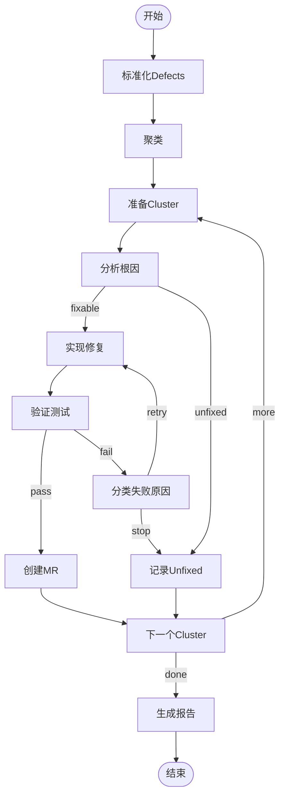

# LangGraph 迁移指南

## 概述

本指南提供从当前的Claude SDK实现迁移到LangGraph编排的详细步骤。

## 前置条件

- Node.js >= 20
- 对现有codebase有基本了解
- 已阅读[可行性分析](./langgraph-feasibility-analysis.md)

## 第一步：安装依赖

### 更新package.json

```json
{
  "dependencies": {
    "@anthropic-ai/claude-agent-sdk": "^0.3.299",
    "@langchain/core": "^0.3.0",
    "@langchain/langgraph": "^0.2.0",
    "@langchain/anthropic": "^0.3.0",
    "@hono/node-server": "^2.1.5",
    "dotenv": "^18.0.7",
    "hono": "^4.13.13",
    "zod": "^4.6.7"
  }
}
```

### 安装

```bash
npm install @langchain/core @langchain/langgraph @langchain/anthropic
```

## 第二步：理解架构变化

### 之前（Claude SDK直接调用）

```
HTTP Request
    ↓
runPipeline()
    ↓
while (iteration < maxIterate) {
    if (analyze) { ... }
    if (implement) { ... }
    if (verify) { ... }
}
    ↓
return report
```

### 之后（LangGraph编排）

```
HTTP Request
    ↓
createBugfixGraph()
    ↓
StateGraph with nodes:
    - normalize → aggregate → analyze → implement → verify → ...
    ↓
Conditional edges handle control flow
    ↓
return report
```

## 第三步：代码迁移

### 3.1 保持现有API不变

**重要**：HTTP API、CLI、导出的函数接口都保持不变。

```typescript
// src/index.ts - 保持不变
export { startServer, createApp } from "./http/app.js";
export { startRun } from "./runs/create-run.js";
export * from "./types.js";
```

### 3.2 添加LangGraph实现

将POC代码移到生产目录：

```bash
cp -r src/langgraph-poc/* src/langgraph/
```

调整import路径（从`../pipeline/`到`../../pipeline/`）。

### 3.3 修改Runner入口

**选项A：渐进式（推荐）**

在 `src/runs/runner.ts` 添加引擎选择：

```typescript
export type ExecutionEngine = "claude-sdk" | "langgraph";

export interface RunnerOptions {
  engine?: ExecutionEngine;
  handlers?: ClusterHandlers;
  maxIterate?: number;
  gitlabToken?: string;
  gitlabHost?: string;
}

export async function runPipeline(
  workDir: string,
  runId: string,
  options: RunnerOptions = {}
): Promise<RunReport> {
  const engine = options.engine ?? "claude-sdk"; // 默认保持向后兼容
  
  if (engine === "langgraph") {
    const { runPipelineWithLangGraph } = await import("../langgraph/runner.js");
    return runPipelineWithLangGraph(workDir, runId);
  }
  
  // 原始实现保持不变
  // ...
}
```

**选项B：完全替换**

```typescript
// 直接使用LangGraph实现
export { runPipelineWithLangGraph as runPipeline } from "../langgraph/runner.js";
```

### 3.4 HTTP API集成（可选：支持引擎选择）

如果想让用户选择引擎，修改 `src/http/app.ts`：

```typescript
// 扩展CreateRunOptions
export const CreateRunOptionsSchema = z.object({
  maxIterate: z.number().int().positive().optional(),
  engine: z.enum(["claude-sdk", "langgraph"]).optional(), // 新增
  // ... 其他字段
});
```

在处理函数中：

```typescript
app.post("/v1/runs", async (c) => {
  const body = await c.req.json();
  const request = parseCreateRunRequest(body);
  const runId = crypto.randomUUID();
  
  await initRun(request.workDir, runId, request);
  
  const engine = request.options?.engine ?? "langgraph"; // 默认使用新引擎
  enqueueRun(request.workDir, runId, { engine });
  
  return c.json({ runId }, 202);
});
```

## 第四步：测试验证

### 4.1 单元测试

为新的graph nodes创建测试：

```typescript
// test/unit/langgraph-nodes.test.ts
import { describe, it, expect } from "vitest";
import { normalizeNode, aggregateNode } from "../src/langgraph/graph.js";

describe("LangGraph Nodes", () => {
  it("should normalize defects", async () => {
    const state = {
      defects: [
        { id: "1", title: "Bug", repoUrl: "https://gitlab.com/org/repo.git" }
      ]
    };
    const result = await normalizeNode(state);
    expect(result.defects).toBeDefined();
  });
  
  // ... 更多测试
});
```

### 4.2 集成测试

验证端到端流程：

```typescript
// test/integration/langgraph-e2e.test.ts
import { describe, it, expect } from "vitest";
import { runBugfixGraph } from "../src/langgraph/graph.js";

describe("LangGraph E2E", () => {
  it("should complete full bugfix workflow", async () => {
    const report = await runBugfixGraph({
      runId: "test-" + Date.now(),
      workDir: "/tmp/test-work",
      defects: [
        {
          id: "1",
          title: "Test bug",
          repoUrl: "https://gitlab.com/test/repo.git"
        }
      ]
    });
    
    expect(report).toBeDefined();
    expect(report.summary.totalClusters).toBeGreaterThan(0);
  }, 60000); // 60s timeout
});
```

### 4.3 对比测试

确保LangGraph版本与原版输出一致：

```typescript
// test/integration/engine-comparison.test.ts
import { describe, it, expect } from "vitest";
import { runPipeline } from "../src/runs/runner.js";

describe("Engine Comparison", () => {
  const testCase = {
    workDir: "/tmp/compare",
    runId: "compare-" + Date.now(),
    defects: [/* ... */]
  };
  
  it("should produce same results", async () => {
    const reportClaudeSDK = await runPipeline(
      testCase.workDir,
      testCase.runId + "-sdk",
      { engine: "claude-sdk" }
    );
    
    const reportLangGraph = await runPipeline(
      testCase.workDir,
      testCase.runId + "-lg",
      { engine: "langgraph" }
    );
    
    // 对比关键指标
    expect(reportLangGraph.summary.fixed).toBe(reportClaudeSDK.summary.fixed);
    expect(reportLangGraph.summary.unfixed).toBe(reportClaudeSDK.summary.unfixed);
  });
});
```

## 第五步：性能优化

### 5.1 启用并行处理

修改graph以并行处理多个clusters：

```typescript
// src/langgraph/graph-parallel.ts
export function createParallelBugfixGraph() {
  // ... 前面的normalize和aggregate保持不变
  
  workflow.addNode("process_clusters_parallel", async (state) => {
    // 并行处理所有clusters
    const results = await Promise.all(
      state.clusters.map(async (cluster, index) => {
        const clusterState = {
          ...state,
          currentCluster: cluster,
          currentClusterIndex: index
        };
        return processOneCluster(clusterState);
      })
    );
    
    return {
      fixed: results.flatMap(r => r.fixed ?? []),
      unfixed: results.flatMap(r => r.unfixed ?? [])
    };
  });
  
  // ...
}
```

### 5.2 添加Checkpointing

支持中断恢复：

```typescript
import { MemorySaver } from "@langchain/langgraph";

export function createBugfixGraph() {
  const workflow = new StateGraph(BugfixStateAnnotation);
  // ... 添加nodes和edges
  
  return workflow.compile({
    checkpointer: new MemorySaver()
  });
}

// 使用时传入thread_id
const report = await graph.invoke(initialState, {
  configurable: { thread_id: runId }
});

// 如果中断，可以恢复
const checkpoint = await graph.getState(runId);
if (checkpoint) {
  await graph.invoke(checkpoint.values, {
    configurable: { thread_id: runId }
  });
}
```

### 5.3 集成LangSmith追踪

```typescript
// 设置环境变量
process.env.LANGCHAIN_TRACING_V2 = "true";
process.env.LANGCHAIN_API_KEY = "your-api-key";
process.env.LANGCHAIN_PROJECT = "bugfix-agent";

// LangGraph会自动发送追踪数据到LangSmith
```

## 第六步：文档更新

### 6.1 更新README.md

添加LangGraph相关说明：

```markdown
## 架构

本项目使用 [LangGraph](https://langchain-ai.github.io/langgraph/) 编排自动化BugFix工作流。

### 执行引擎

支持两种引擎：

- **langgraph**（默认，推荐）：使用LangGraph StatefulGraph
- **claude-sdk**（传统）：直接调用Claude Agent SDK

通过 `options.engine` 选择：

\`\`\`json
POST /v1/runs
{
  "workDir": "/tmp/work",
  "defects": [...],
  "options": {
    "engine": "langgraph"
  }
}
\`\`\`
```

### 6.2 添加可视化图表

使用Mermaid展示流程：

````markdown
## 工作流可视化


````

## 第七步：部署发布

### 7.1 版本升级

```json
{
  "name": "bugfix-agent",
  "version": "0.2.0",
  "description": "Local dual-outcome bugfix agent powered by LangGraph"
}
```

### 7.2 更新CHANGELOG

```markdown
## [0.2.0] - 2026-10-16

### Added
- LangGraph state machine for workflow orchestration
- Support for engine selection (langgraph/claude-sdk)
- Checkpointing for workflow resumption
- LangSmith integration for tracing

### Changed
- Default engine changed to "langgraph"
- Improved error handling with stopReason state

### Deprecated
- Direct Claude SDK runner (still available via engine option)
```

### 7.3 发布

```bash
npm run build
npm test
npm version minor
npm publish
```

## 常见问题

### Q1: 迁移后原有的测试失败了？

A: 检查：
1. 是否正确导入了新的函数
2. 是否传入了正确的`engine`参数
3. 状态管理是否有差异（LangGraph的state是不可变的）

### Q2: 性能比之前慢？

A: 可能原因：
1. 没有启用并行处理
2. Checkpointer配置了持久化存储（改用MemorySaver）
3. 日志输出过多

优化方法：
- 使用并行版本的graph
- 禁用不必要的追踪
- 调整maxTurns

### Q3: 如何调试LangGraph？

A: 使用以下方法：
1. LangGraph Studio可视化调试
2. 添加节点级日志：
   ```typescript
   const analyzeNode = async (state) => {
     console.log("Analyze node input:", state);
     const result = await analyzeCluster({...});
     console.log("Analyze node output:", result);
     return result;
   };
   ```
3. LangSmith追踪（需要API key）

### Q4: 能否混用两种引擎？

A: 可以。每个run独立选择引擎，通过`options.engine`控制。

## 回滚计划

如果LangGraph出现问题，可以快速回滚：

### 选项1：改变默认引擎

```typescript
// src/runs/runner.ts
const engine = options.engine ?? "claude-sdk"; // 改回默认
```

### 选项2：禁用LangGraph

```typescript
// src/runs/runner.ts
export async function runPipeline(...) {
  // 强制使用Claude SDK
  // if (options.engine === "langgraph") { ... }
  
  // 直接执行原始逻辑
  await updateRunMeta(...);
  const loaded = await loadRequest(...);
  // ...
}
```

### 选项3：版本回退

```bash
git revert <commit-hash>
npm version patch
npm publish
```

## 总结

迁移到LangGraph的核心优势：

✅ **可维护性**：声明式图结构，易于理解和修改
✅ **可扩展性**：轻松添加新节点和分支逻辑
✅ **可调试性**：LangGraph Studio可视化，LangSmith追踪
✅ **性能**：支持并行处理和智能缓存
✅ **兼容性**：保留Claude SDK，平滑过渡

**建议的推进策略**：

1. **第1周**：完成代码迁移和基本测试
2. **第2周**：Beta用户验证，收集反馈
3. **第3周**：性能优化，文档完善
4. **第4周**：正式发布，默认启用

---

**下一步**：阅读 [POC README](../src/langgraph-poc/README.md) 了解实现细节。
