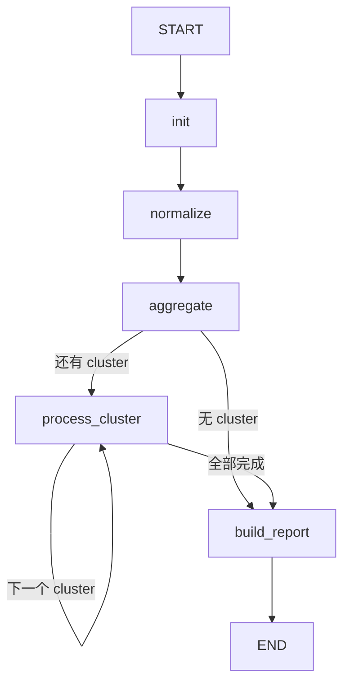
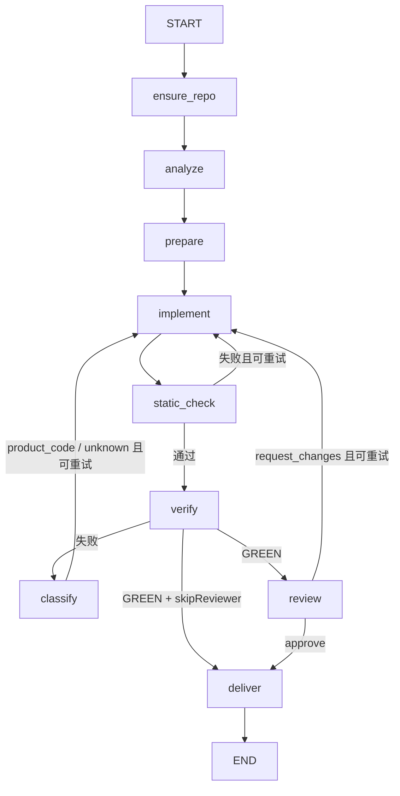

# LangGraph 引擎

bugfix-agent 提供两种编排引擎，底层 Agent 调用（analyze / implement / review）都仍然走 `@anthropic-ai/claude-agent-sdk`：

| 引擎 | 入口 | 说明 |
|------|------|------|
| `pipeline`（默认） | `src/runs/runner.ts` | 原有命令式 while 循环 |
| `langgraph` | `src/graph/` | `@langchain/langgraph` StateGraph，可部署到 LangGraph Server / Studio |

两者复用同一组 `src/pipeline/*` 步骤函数，产物目录（`{workDir}/.bugfix-runs/{runId}/`）、`reasonCode`、报告结构完全一致；`test/integration/langgraph-engine.test.ts` 对同一组场景分别跑两个引擎并逐项比对报告和各步骤调用次数。

## 图结构

### 运行图 `createBugfixGraph()`



- `init`：用 `CreateRunRequestSchema` 校验输入；未传 `runId` 时自动创建运行目录（LangGraph Server 场景）。
- `process_cluster`：串行调用 cluster 子图（同一仓库的多个 cluster 共用工作区，并行会互相踩踏）。
- `fixed` / `unfixed` 使用追加 reducer 累积。

### Cluster 子图 `createClusterGraph()`



任一节点写入 `outcome`（fixed 或 unfixed）即终止到 `END`，与旧 runner 中每个 `return unfixedBase(...)` 一一对应。`maxIterate` 由 static check / verify / review 三个门禁共享。

## 使用方式

### 1. npm 包 / HTTP API（选择引擎）

```json
POST /v1/runs
{
  "workDir": "/data/batch",
  "defects": [ ... ],
  "options": { "engine": "langgraph", "maxIterate": 3 }
}
```

代码中也可以通过 `RunnerOptions.engine` 覆盖：`createApp({ runner: { engine: "langgraph" } })`。

### 2. 直接调用图

```ts
import { createBugfixGraph, invokeBugfixGraph } from "bugfix-agent/graph";

const report = await invokeBugfixGraph({ workDir, defects, options: { skipReviewer: true } });

// 或自行编译、挂 checkpointer、stream
const graph = createBugfixGraph({ checkpointer: new MemorySaver() });
for await (const chunk of graph.stream({ workDir, defects }, { configurable: { thread_id: "t1" } })) {
  console.log(chunk);
}
```

`createBugfixGraph` 接受 `handlers`（替换任意步骤，便于测试或定制）、`maxIterate`、`gitlabToken`、`gitlabHost`、`checkpointer`。

### 3. LangGraph CLI / Server / Studio

仓库根目录的 `langgraph.json` 注册了图 `bugfix`（`src/graph/langgraph.ts:graph`），npm 包内也通过 `bugfix-agent/langgraph` 导出同一个已编译图。

```bash
npx @langchain/langgraph-cli dev     # 本地 Server + Studio
```

```bash
curl -X POST localhost:2024/runs/wait -H 'content-type: application/json' \
  -d '{"assistant_id":"bugfix","input":{"workDir":"/data/batch","defects":[...]}}'
```

在其他项目中把 npm 包里的图挂到自己的 LangGraph 部署：

```json
{
  "node_version": "20",
  "dependencies": ["."],
  "graphs": { "bugfix": "./node_modules/bugfix-agent/dist/langgraph.js:graph" }
}
```

输入字段：`workDir`、`defects`、`userPrompt?`、`options?`、`runId?`；输出 state 中的 `report` 即双结局报告。

## 递归上限

LangGraph 默认 `recursionLimit` 为 25。`invokeBugfixGraph` / 旧 runner 委托时会按 defect 数量自动放宽；cluster 子图按 `maxIterate` 计算上限。经 LangGraph Server 调用且 cluster 数超过约 20 时，请在请求的 `config.recursion_limit` 中调大。
