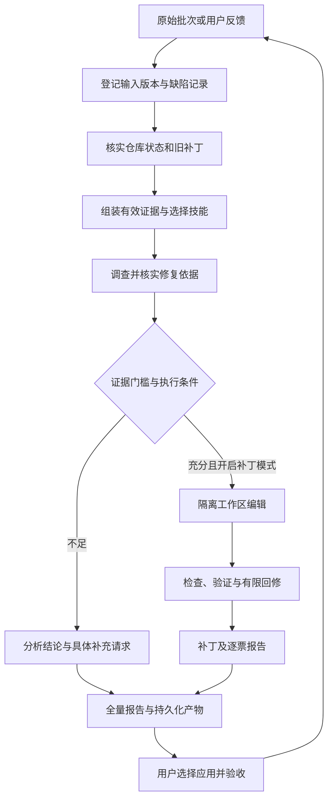

# Agent-3 证据驱动修复与用户反馈闭环方案

日期：2026-11-15（Asia/Shanghai）。修订：同日第二轮完整审查。状态：完整设计稿，待评审；用户已授权产出方案，尚未实施。本文件是目标设计，不表示下述能力已存在，也不声明实仓修复成功率。无需兼容旧契约。

## 1. 讨论来源与决策边界

本方案承接以下本地材料，后续用户明确的要求优先于早期建议：

- [Agent-3 方向讨论记录](2026-11-13-agent3-direction-discussion.md)：职责、异构验证、逐票上下文、技能及用户反馈。
- [每票上下文与用户反馈完整示例](2026-11-14-agent3-feedback-context-example.md)：相机断开、首次阻断、补充日志、再次修复；属于虚构行为示例。
- [2026-11-15 证据门槛与报告讨论补充](2026-11-15-agent3-evidence-report-discussion.md)：本方案前最后几轮讨论及用户确认的交付边界。
- [自动修复系统调研](../../research/2026-10-14-sota-bugfix-agent-survey.md)、[Agent-1/2 历史产物审阅](../../research/2026-11-13-agent1-agent2-historical-artifact-review.md)：问题依据与证据限制。
- [11-11 分析与受控改码规格](2026-11-11-agent3-sdk-analyze-and-gated-fix.md)：现实现背景。本稿拟替代其报告状态、修复生命周期和交付部分；只有方案获确认并实施后，才成为运行行为。

用户已明确：效果优先；保留有价值的 Agent-2 逐票调查；允许改 Agent-1/2 契约；业务测试环境异构；可注入业务 skill；报告覆盖所有缺陷；用户自行选择、应用和验收补丁，再反馈。Agent-3 不自动推送、合并或部署。

设计选择：持久缺陷记录 + 每轮独立执行 + SDK 会话按需恢复。既不每轮丢弃调查重新开始，也不维持一个永不结束、跨票共享全部历史的会话。前者浪费调查，后者难以处理版本变化、失败恢复和错误假设。

## 2. 目标与完成定义

目标是提高真实修复的有效性，同时让未修复缺陷也能继续推进。一次运行完成的含义是：每张输入缺陷都有可追溯的处理结果，补丁和验证声明有对应证据，阻断有具体说明，下一轮可以从有效状态继续。

“产出补丁”“工程检查通过”“业务验收通过”是三个不同事实。无完整业务环境仍允许交付未验证补丁；已确认补丁引入的检查失败不得包装成可供正常应用的候选。

本期不建设自动发布、自动 MR、生产操作、统一设备测试平台或无限多候选搜索。首期以 CLI/产物反馈为完整入口；HTTP 复用同一应用服务，交互式报告界面另行扩展。不是只有 UI 完成后才能二次投递。

### 2.1 修复收益优先级与范围约束

本次审查发现初稿偏重记录与基础设施，不能把“状态更完整”直接等同“修复更好”。实现投入按下表排序，并逐项验证收益：

| 优先能力 | 直接解决的问题 | 判断收益的证据 |
|---|---|---|
| 原文/附件可访问，Agent-2 逐票事实可核对 | 错误预期、幻觉定位污染修复 | 关键事实错误下降、错误线索更快被排除 |
| 当前代码的机制核实与有针对性的反证 | 找对文件但修错原因 | 人工机制审阅、缺陷相关行为检查 |
| 编辑后语义复核与验证回修 | 补丁能编译但没解决问题，或制造回归 | 原失败路径改变、正常路径保留、真实验收 |
| 一致基线与完整补丁 | 修错版本、漏新增文件、掺入用户改动 | 补丁可应用且内容符合预期 |
| 用户反馈与有效状态续接 | 每轮从头调查或叠加错误补丁 | 补充后推进、拒绝后纠正及调查成本 |
| 可追溯报告和可靠落盘 | 用户无法选择、验收或续修 | 全量覆盖、证据可查、恢复可用 |

首期不建设通用事件溯源平台、全仓依赖失效图、语义补丁冲突引擎、自动服务编排或自研跨平台沙箱。第 7 节对象首先是同一 attempt 文档中的逻辑结构，不要求每项独立表、服务或状态机。数据完整性是修复底线，存储规模化不是验证修复收益的前置条件。

## 3. Agent 分工与上下游调整

### Agent-1：保真资料准备

- 输出原始描述或稳定引用、附件清单、前置条件、测试数据、字段来源与输入版本；提炼内容保留原文定位。
- 区分原文明示的预期、推断预期、无关模板、冲突和缺失；字段非空不等于验收条件可靠。
- 输出输入清单和逐项处理去向，不能静默丢弃行。缺失 ID 可分配导入记录 ID，重复业务 ID 保留来源后归并，冲突不得直接覆盖。
- 早期“缺信息/疑似外部组件”是调查提示，不是永远禁止 Agent-3 调查的判决。明确由用户或运行策略排除的项可不调查，但仍进入总报告并解释。
- 若入口知道仓库版本可记录，但 Agent-2/3 均重新采集其实际使用的代码状态；不假设 Agent-1 当前已实现完整 Git 状态采集。

附件不能只保存文件名：入口核实实际可访问性，截图由支持图像的模型/工具读取并记录观察；日志保留必要原文与场景。链接无法获取、格式不支持或模型未实际查看时明确标为未读取，不能凭附件标题编造内容。首期优先支持文本与图片，视频可请求关键帧和步骤，不先建设通用媒体平台。

### Agent-2：保留逐票调查，减少无依据内容

输出分为仓级知识与逐票调查。仓级知识只保留有导航价值的业务入口、模块关系、外部依赖、规范和验证入口。逐票调查输出代码事实、候选机制、证据引用、已查范围、排除项、归属判断和未决问题。

每票显式区分未调查、仅搜索底稿、部分调查、调查完成、调查失败；整个 run 完成不推导逐票充分调查。事实必须有实际读取或检索证据；文件名子串命中只算线索。允许零候选与明确不知道，禁止为完整性填充候选。根因假设可以深入，但保留推断性质和反证条件。

来源类型、调查覆盖与结论可靠性分别记录，不能用 `source=codegraph/grep` 或统一 medium 替代。路径/符号存在性、实际片段、代码版本、工具记录关联由程序校验；因果是否成立仍需 Agent-3 核对，结构校验不能证明语义正确。

Agent-2 的逐票覆盖必须真实：当前 `sdk/cartography.py` 的 `MAX_PROMPT_TICKETS=16` 及选票切片意味着大批次不能默认全部进入调查。改为可配置小批分组及逐票覆盖清单；预算不足的票显式留作未调查，由 Agent-3 承接，不通过简单扩大一次 prompt 解决。优先交付每票少量高价值证据，避免深挖前几票耗尽整批预算。

Agent-3 重读编辑目标及关键调用点是必要核实；应避免重复整仓搜索与重走已证伪路径。Agent-2 交接资料允许按票读取，无需把全部仓图与全部票注入每个会话。

### Agent-3：对本轮判断、修改与交付负责

核对上游证据，恢复有效缺陷状态，调查关键歧义，决定是否改码，生成完整补丁，执行可用验证并有限回修，形成逐票及批次报告。用户补充后重新评估原阻断；无需机械重跑 Agent-1/2。

首期 Agent-3 自行补充当前票必要调查，涉及新仓时可接受新一份 Agent-2 产物；不以建设 Agent-3 自动调度 Agent-2 的回调链为前提。未来批量复用明显有收益时再由应用服务调度刷新，避免循环调用两个 Agent 重复分析。

## 4. 总体结构与执行流程

沿用 Python + Pydantic + LangGraph 外编排、Claude Agent SDK 执行推理。确定性规则负责标识、版本、工具边界、持久化、结构校验与报告汇总；模型负责语义调查和修复推理。



保留 analyze-only 和 generate-patch 两种运行模式，默认 analyze-only；analyze-only 不修改产品源文件，但允许在临时目录执行获准的已有测试、观察与复现；需要写诊断源代码时仅在明确允许的隔离副本进行，且不交付修复候选。调用方选择 generate-patch 即授权在隔离目录生成补丁，无逐票确认要求。模式不授权修改用户源工作区或执行远端交付。

分析、编辑、验证是可恢复阶段，不强制各自一定一个 SDK 会话。编辑前必须经过程序检查的 evidence gate；编辑会话取得缺陷理解、证据、有效假设、业务约束、修改范围、基线和验证条件，而非只有根因摘要。

调查优先回答当前最关键的问题：核对 Agent-2 的一个最强线索，追踪相关输入—状态—输出，比较正常路径，再尝试一个能推翻当前解释的检查。强线索被推翻时换路径，不为了“使用上游产物”持续沿错误线索深挖。调用链和业务规范只按当前票裁剪，不把整仓知识重复注入。

CodeGraph 是导航工具，不是源码真值。索引版本不明、存在 pending 或工作区变化时，用当前文件重新核实关键片段；不能强制先走图，也不能禁止对图结果再次 Read/Grep。`shell/host/route_table` 等入口仅作为通常低优先级线索，有路由、挂载、配置证据时可成为真实修复点。保留现有规范发现能力，并将 conventions、相关 spec 和 repo 身份真正传入分析与编辑。

每票独立故障边界。一票失败不能抹去已完成结果或阻止其余票收尾。批次先登记全量记录，随后逐票填充；未执行项也有明确原因。整进程中断时，重启通过持久记录重建部分报告，将未完成阶段标为 interrupted。

## 5. 改码证据门槛

必须同时具备：

1. **行为目标**：明确异常与希望恢复的行为；会改变修法的业务冲突已解决。
2. **代码关联**：当前仓库确实参与该行为，编辑目标及关键代码已核实版本。
3. **机制解释**：已观察代码、日志或实验能支持具体失败机制，不只是词面匹配或常见经验。
4. **修改论证**：说明改动如何消除该机制，兼顾正常、失败与相关状态路径。
5. **执行前提**：处于补丁模式，可创建一致的隔离基线，关键证据可追溯，改动范围可确认。

使用 `EditDecision` 保存每项结论及 evidenceRefs、未决关键问题和裁决原因。程序拒绝缺引用、失效引用、占位分析及关键问题明确未解决的决定。既有修改目标需要读取核实；新增文件则核实其父目录、调用方、接口和必要性，不要求不存在的文件已读。是否消除了语义歧义由分析结论解释，程序只校验结构、来源与状态，不能声称自动证明根因正确；模型负责解释因果，不依赖摘要关键词或 confidence 分数授权编辑。预算耗尽不直接禁止已有充分证据，但必须完成门槛核对；无法完成时不编辑。

不要求所有票先本地复现。确定的参数传反、分支遗漏、文案错误可由静态证据支持。性能、时序、偶发故障若存在不同修法的竞争假设，需进一步取证。UI 的“正确样子”存在歧义时，请求截图、设计图或业务说明。

可在隔离目录制作诊断日志、最小复现和模拟输入，但标为诊断产物，不作为修复补丁混入。诊断修改影响最终 diff 时必须逐项决定保留或移除，并检查最终补丁。

## 6. 缺信息、仓库归属与调查停止

先理解现象/预期，再确认产品与代码关系，沿最有依据路径核实调用链及规范。继续调查必须有可回答的问题、预期可获得的证据，以及证据如何区分假设的说明。

以下情况结束本轮调查并报告：关键行为需业务决定；竞争机制无法通过现有代码区分；需要不可获得的运行日志/截图/环境；到达不可访问组件边界；连续探索不产生新事实或排除项；资源预算耗尽。

不采用“两个工具调用/两次无进展就停止”的硬门槛，读取一个调用链通常需要多次操作。模型在阶段小结中说明新增证据、排除项和下一项可区分假设的行动；重复同类搜索且无法给出新检验理由时收尾。首期用可配置每票轮次/超时/成本上限兜底，并预留报告收尾预算，后续按真实轨迹校准进展规则；不开发自动信息增益评分器。预算由显式参数、环境配置、默认值依次解析并记录实际生效值，避免现有默认参数遮蔽环境配置。总预算耗尽的结果是 incomplete，不是无法修复。

归属取值：in_scope、external_confirmed、external_suspected、unknown。明确外部归属需要组件/接口/运行证据；搜索无结果只能支持 unknown。Web 仓里的 iOS 报告可能涉及 WebView；设备报错可能涉及前端处理，不能关键词直接拒绝。

补充请求包含：所需材料、它要解决的具体歧义、为什么影响修法、建议取得方式、是否有低成本替代材料。优先最能区分假设的少量材料，不默认要求完整环境。运行内不等待用户，报告后结束本轮，反馈触发新 attempt。

## 7. 缺陷记录与契约

新契约统一版本升级，旧格式不静默兼容；新版本内证据深度允许不齐：缺少 Agent-2 调查记录时标记未调查并让 Agent-3 自取证，不要求所有上游增强完成后才能跑修复。给出版本不支持的明确错误及重新生成提示。输入若结构损坏，登记 import error；能够读取身份的项仍出报告，无法解码的原始文件登记批次错误，不伪造缺陷数量。

| 对象 | 关键内容与语义 |
|---|---|
| 批次清单（目标设计） | batchId、输入文件摘要、每个输入项/重复映射、仓库集合、模式、预算和模型配置 |
| 缺陷记录（目标设计） | 项目命名空间 + 源缺陷 ID；持续身份、当前 revision、最新 attempt、最新有效状态 |
| InputRevision | 不可变原始票面/补充/附件引用、来源、时间、父版本、纠正关系 |
| Attempt | attemptId、父 attempt、输入 revision、工作区快照、阶段状态、会话引用、产物及成本 |
| Evidence | evidenceId、类别、来源、观察时间、内容摘要/持久引用、仓库/版本/文件定位、适用场景、有效性 |
| Hypothesis | 主张、支持/反对证据、待验证点、proposed/supported/refuted/superseded 及变更原因 |
| EditDecision | 第 5 节各条件、引用、裁决、当前代码快照、未决问题 |
| WorkspaceSnapshot | repoId、HEAD、dirty 清单、内容清单摘要、相关未跟踪文件、子模块状态、捕获时间 |
| PatchSet | patchSetId、候选版本、逐仓补丁与摘要、基线、目标文件、依赖/冲突、替代关系、交付状态 |
| VerificationRun | 命令/工具、cwd、环境摘要、输入补丁/代码摘要、退出码、日志、覆盖范围、结果及失败归因 |
| Feedback | feedbackId、目标 attempt/patch、应用情况、测试结果、文本/附件、用户声明的版本、接收状态 |
| SkillUsage | 技能身份/版本、适用仓/阶段、触发理由、读取/调用证据、完成步骤与输出 |

用户陈述、代码观察、工具结果和模型推断分开；Agent-2 与 Agent-3 引用同一源码不计作两份独立运行证据。失效证据保留历史，不能继续通过改码门槛。

证据有效性采用以下最低规则：每个新 attempt 的旧 EditDecision 一律不继承授权，必须重新裁决。代码事实记录观察时的文件内容摘要；因果判断另外记录本票实际依赖的少量关键调用方、配置、协议与依赖版本，不建设自动全仓依赖图。相关范围变化则重新读取和判断；无法确定变化是否相关时降为待复核，而非默认为仍有效。源码片段未变只说明该观察仍可复用，不证明整个机制仍成立。用户日志保留为对应版本/场景下的历史事实，新版本适用性单独判断。验证结果只适用于所记录的候选与环境，复用必须说明未受影响的依据。证据可取 valid/pending_review/invalid/historical，只有本轮已核实的适用证据可支持 EditDecision。

状态按维度表达，避免单 outcome 承担全部语义：

- execution：queued/running/completed/failed/interrupted/skipped。
- resolution：patch_produced/analysis_only/needs_information/needs_environment/needs_business_decision/external_component/unlocalized/incomplete/excluded。
- patch delivery：none/candidate/diagnostic/superseded/withdrawn。candidate 不表示业务已修复。
- verification：每项 passed/failed/blocked/not_run/not_applicable，并有范围；不强行汇总成全局 passed。
- user application：unknown/not_applied/applied/partially_applied/modified/discarded。
- user acceptance：pending/accepted/partially_resolved/rejected/regression_reported，绑定所验补丁与场景。

`accepted` 不由模型自动设置。用户明确验收可记录为用户报告通过；未提供执行证据时不伪装平台亲自验证。无补丁时可以完成分析，但不会标为修复完成。

## 8. Git、隔离工作区与补丁完整性

HEAD 识别提交基线，不能单独识别实际文件。每轮记录仓库身份、HEAD、tracked 修改、相关 untracked 文件与内容摘要。多仓分别采集；容器目录本身不必是 Git 仓。

先登记本轮输入代码状态，在同一内容基线上调查与编辑，避免分析 dirty 原目录却编辑 HEAD。批次可共用一个不可变基线，按需为需要诊断/编辑的票创建工作副本；纯只读调查可直接读取源仓，但关键读取前后校验版本/文件摘要，发现变化重新核实，进入编辑前核对并冻结基线。不要求给每张排除或补单票复制整仓。干净仓可用独立 worktree；dirty 仓把已登记的修改与必要未跟踪源文件重放至隔离快照并核对内容。默认不复制 node_modules、构建目录、凭据和全部 ignored 文件；运行所需的 ignored 配置按明确能力配置取得并记录，缺失则报告环境限制。

复制期间源目录变化导致摘要不一致时重新捕获，持续变化则阻断编辑。缺少必要基线内容、无法可靠捕获二进制/子模块变动时保留分析结果并说明阻断，不能改用错误 HEAD。

worktree 身份使用 repoId + defectKey 的稳定摘要 + attemptId，禁止仅使用截断后的可碰撞工单名。复用必须检查归属、基线和已知变更；未知残留隔离保存，不自动当作前次有效修复。用户源工作区始终不回滚、不清理、不自动应用补丁。

补丁从隔离输入快照到最终快照计算，只含 Agent3 本轮变更；不能把原有用户修改混入。首期完整支持普通源文件的新增、修改、删除及重命名等价表示（删除 + 新增也可），并检查意外模式变化。二进制、特殊文件模式和子模块变更仅在导出与应用校验已支持时交付；否则明确不支持并保留分析，不能静默遗漏，也不把完整支持所有 Git 边角情况作为首期前提。用独立临时索引/快照处理新增文件，不能仅依靠默认 git diff。

补丁交付前在等价基线检查可应用性及最终内容摘要。dirty 基线补丁明确依赖前置用户变化；不声称可直接用于干净 HEAD。归档必要基线清单与差异，使用户能核对前提，不复制整份业务仓到报告中。

联合多仓编辑是扩展目标：实现时一票多仓使用一个 PatchSet 下的多份补丁，注明共同依赖与应用顺序，不模拟跨仓原子提交。首期必须能在多仓容器中找到并修改实际目标仓，但可以暂不支持同票联合修改多个仓；此时报告执行能力限制，不能误判成代码在仓外。缺少关键仓时可交付独立有效的本仓修复，但依赖未提供外部修改才能成立的部分仅作诊断/建议，不冒充完整修复。

跨票由程序检测文件/区域重叠，模型记录已发现的共享修改与依赖；不宣称自动发现所有语义依赖，不建设通用语义冲突引擎。机械无冲突不等于语义兼容；未做组合验证就明确标记。共享根因可关联同一补丁，不因票面分簇直接认定同根因。首期不自动合并全部候选。

## 9. 验证与有限回修

验证能力来自项目脚本、现有测试、业务 skill、用户补充和可用工具。先识别条件与成本，再选择与修改有关的检查，不硬编码统一设备测试方法。

1. 执行适用的语法/类型检查与编译；已有可运行相关单测必须运行。
2. 缺陷机制适合低成本用例或模拟输入时增加针对性验证，不机械要求每票新建测试框架。
3. skill/反馈提供可用业务环境启动方法时按说明启动测试，记录环境条件、操作和结果。
4. 没有环境或凭据时标记 blocked/not_run，给出剩余验收步骤；不能写成通过。

交付前对最终 diff 做一次语义复核：逐项对照用户预期、机制证据、正常/失败/重试路径、业务规范和修改范围，检查是否只是遮蔽错误、硬编码样例、放宽断言或删除测试。默认复用当前执行阶段完成，不强制每票再调用独立 reviewer；高影响或争议候选再按成本配置采用独立审查。发现新的关键歧义则返回调查，不强迫编辑器照旧方案改完。

新增回归测试尽可能验证原基线失败、候选通过；若原基线也通过，则该测试只能算普通回归覆盖，不能作为缺陷修复证据。与现象无关的测试通过不能提高对该机制的判断。不要为获得 GREEN 删除、跳过或弱化原有检查；确属错误的旧断言需单独解释业务依据。

失败按补丁引入、基线已有、环境依赖和原因未知区分。需要归因时在相同条件验证基线，避免重复全量运行或修无关历史问题。通过的检查也必须说明是否覆盖目标行为。

默认每 attempt 最多三次候选编辑—验证迭代，属于可调整初始配置而非效果定律，总预算可更早结束；每次回修有明确失败证据和新的修正理由。同一机制连续无进展则停止并报告。修改后只复用与最终内容无关的验证；受影响项必须重跑。

补丁引入失败且未修复，或关键检查失败归因未知：保留 diff 作为 diagnostic，并明确不建议应用。纯环境阻断允许 candidate，但记录未验证范围。适用检查全部通过也只说明对应范围；业务验收仍由用户反馈。

执行工具由平台提供，skill 不自行创造权限。允许隔离目录中的构建、测试与必要服务管理；记录命令、cwd、退出码、超时和输出。服务端口/进程归属于 attempt，结束时清理自身创建的资源。涉及外部设备的写操作仅在用户提供的测试授权范围内执行；范围不明则报告，不能因测试说明而推定允许生产变更。

执行后端采用现有能力，不建设自研跨平台沙箱。首期分成受控文件编辑、项目检查命令和业务验证三类入口：文件编辑限制实际解析路径；检查在工作副本执行明确的项目命令，带 cwd、超时和日志；业务验证使用用户/skill 指定且符合运行配置的步骤。依赖安装按锁文件和配置执行，不自动升级依赖；缺依赖单独报告。命令可能修改生成物，最终只纳入经语义复核的必要源文件变化。

有现成容器/SDK 沙箱时优先限制写入工作副本、临时目录和专属缓存，源仓只读。也允许用户运行配置明确选用受信任的宿主项目命令，以适应 Windows/Electron/设备测试；这属于操作范围约束与审计，不能声称具有 OS 级强隔离。首期不向模型开放未受策略控制的任意宿主 Bash。宿主执行前后核对源仓状态，检测越界立即停止、记录差异且不自动回滚用户文件；该检查用于发现问题，不能代替事前隔离。

不能满足某条命令的执行条件时只将该项验证标为受限，仍保留可安全进行的调查、编辑与其他检查。缺少容器不等于整个项目不能验证；依赖宿主的业务环境也不强制先开发专用设备适配平台。具体运行配置在启动时明确，正常轮次内不引入逐命令人工确认流程。

## 10. Skill 发现、选择与复用

业务 skill 承载产品事实、接口语义、修复约束和环境方法；内置开源 skill 提供调查、框架调试、验证方法。平台执行边界始终有效；业务规范与通用方法冲突时按具体项目判断，影响修法的业务冲突必须显式记录，不能静默覆盖。

精选首批候选：systematic-debugging、verification-before-completion、webapp-testing；现有 Vue、Electron、monorepo 等项目方法继续按适用性保留。候选并非已安装或已证明有效，纳入发行前核对来源版本、许可、完整引用资源与适配差异。

技能身份使用来源/仓库作用域/名称/版本，禁止同名跨仓全局覆盖。先提供元数据，再按缺陷意图、框架、阶段与环境完整加载相关正文及必要支持资源，不固定截断到 2400 字符。不强制把通用 TDD/人工审批流程带入每张票。

固定 SDK/CLI 版本后可使用已验证支持的原生技能发现与调用；受控 plugin 目录及 setting sources 显式配置，避免继承宿主无关个人技能。若版本不支持所需加载方式，适配层采用元数据 + 完整文件读取，保持同一 SkillUsage 记录。实现前以 smoke test 验证工具可见、引用可读、调用可观测，不能仅凭配置推断已执行。

首期先使用现有 skill 目录及完整文件读取，复用当前发现流程并修复元数据解析、作用域和截断；不等待迁移为原生 plugin。方法类 skill 按需少量启用，新增技能通过具体案例比较错误率、成本与可执行性，再决定是否默认启用。

记录 discovered、selected、read/invoked、applied、blocked 的区别。第二轮复用已得到的事实和操作结果，重新检查适用性；“上轮绑定过”不代表本轮执行过，技能指令也不算验证证据。

## 11. SDK 会话与持久状态

SDK 保存可获得的对话历史和工具交互；应用保存业务状态、版本化证据、补丁、工作区身份及多会话映射。不声称保存不可见内部推理。sessionId 是定位符，不是完整备份，也不等于 defectId。

会话决策：

| 情况 | 决策 |
|---|---|
| 同票、基线兼容、方向连续、会话可得 | resume 指定 session，注入新增事实和失效项 |
| 保留原调查尝试另一解释 | fork 指定 session；编辑需要另建隔离工作区 |
| 新仓/显著版本变化、旧理解被推翻、历史污染或会话不可得 | 新 session，加载有效状态和必要证据 |

不使用 cwd 的最近会话猜测票身份。会话适配器记录 SDK/CLI/model 版本、cwd、sessionId 和持久位置；跨主机必须确认历史可用，不可用则新会话继续。原始会话丢失可降低审计完整性，但不应丢失缺陷进度。

恢复包包含：当前票面与补充、有效事实、待验证/已否定假设、调查范围、代码快照、旧补丁状态、验证证据、skill 状态和本轮目标。完整历史留档按需检索，不每次全部灌入；关键原文不能只保留有损摘要。

SDK 文件 checkpoint 可作为编辑辅助，但不能替代 Git/快照/补丁。恢复对话不恢复文件，回退文件也不会自动撤销模型旧判断。

## 12. 二次投递协议与并发规则

反馈导入包含项目/缺陷身份、目标 attempt/patch（可未知）、用户文本及附件、应用状态、验收结果、当前仓库位置或版本。未知不是非法反馈，先存档再调查；不能猜成“最新补丁已应用”。

处理顺序：

1. 通过客户端 feedbackId 或显式幂等键去重，保存不可变反馈，关联旧轮次。内容摘要仅提示可能重复；同样一句“仍未修好”在不同测试轮次可能是新的反馈，不能仅凭文字相同丢弃。
2. 采集实际代码；比较 HEAD、文件内容、已应用补丁的效果和用户额外修改。用户测试构建与源码对应不清时保留未知。
3. 更新输入 revision，明确哪些事实新增、哪些假设失效、哪些阻断解除。
4. 确定旧补丁关系：未应用则通常生成替代版；已应用则针对当前代码追加修复；部分应用/人工修改则逐处核对；无法确认则不盲目重放。
5. 选择会话与相关知识刷新范围，开始新 attempt。
6. 保存新报告，明确新补丁是替代旧补丁还是以已应用版本为前提。

首期同一项目产物目录采用单写入运行锁，票顺序处理；第二个写入任务明确返回 busy，用户可稍后重投，不静默覆盖。本轮输入固定，反馈可独立写成待导入文件，下一次显式调用开始新 attempt；不需要自动后台队列。过期反馈仍保留并标注针对旧候选，不直接改写最新验收状态。后续确有吞吐需求再增加逐票锁、事务索引和并发调度，不能把这些作为二次投递前提。

## 13. 全量报告与交付包

首期交付可阅读 Markdown、机器可读 JSON、逐票补丁与附件索引；HTML 可由同一数据渲染，非首期前提。主报告为一个入口，通过锚点/链接进入每票详情。内容由已验证的结构化记录生成，模型不能单独编造汇总计数或执行结果。

### 批次概览

记录批次、日期、输入版本、仓库/基线、运行模式、环境能力、覆盖数量及执行限制。表格含缺陷 ID/标题、本轮结果、核心结论、补丁、验证范围和下一步。

全部输入项有去向：已调查、补充信息、外部阻断、未定位、失败、中断、排除、重复关联。排除项不必烧模型，但要有依据；重复项链接主票。统计明确唯一缺陷数与原始输入项数。导入清单缺失时只能声明覆盖已收到的列表，不能宣称覆盖原始平台所有缺陷。

### 每票详情

1. 原始现象、预期、补充与歧义；推断明确标注。
2. 本轮结论、归属、执行状态及阻断。
3. 支撑因果解释的代码/日志证据，主要排除项与剩余假设。
4. 修改理由、范围、行为影响、补丁链接及依赖/冲突。
5. 实际执行的验证、对应候选、结果与未覆盖范围。
6. 具体业务验收步骤与预期结果；建议步骤不能放在已通过项下。
7. 补充请求：材料、原因、获取方式与预期用途。
8. attempt、代码基线、旧补丁关系、反馈入口及详细证据索引。

无补丁票同样具备分析正文。不向普通报告堆全部工具轨迹，保留关键证据与详情入口。

示例摘要：

> 相机断连后等待状态不结束。已核对失败消息与页面处理分支，候选补丁处理失败终态并清理重试前状态。编译和模拟 IPC 单测通过，真实 USB 断连/重连未执行。请审阅后应用本候选，验证断连后结束等待、错误保留及重连后可重试。补丁依赖桌面仓本轮快照；驱动仓未修改。

### 用户反馈模板

```text
缺陷 ID / 报告轮次：
补丁：未应用 / 完整应用 / 部分应用 / 应用后手改 / 丢弃 / 不确定
结果：通过 / 部分解决 / 未解决 / 新问题 / 不接受修改
实际代码或构建版本（知道时填写）：
现象、期望、操作过程及附件：
```

模板帮助表达，不强制用户手写全部内部标识。导入器从报告引用、目录和文件推断可核实的信息；有歧义则保存反馈并请求最少补充。

每轮报告不可变，另生成 latest 汇总展示当前进展。历史结论、用户反馈和新版报告并存，不回写旧报告伪造当时已知信息。

## 14. 持久化、恢复与故障处理

首期沿用本地 JSON 产物方式，增加逐票 attempt 目录、相对引用、原子文件替换和运行锁。当前 http/store.py 已有临时文件替换的基础，优先复用其模式并补足关键错误处理。SQLite、内容寻址对象库和跨进程任务队列延后到检索规模/并发确有需要时；不同时引入两套事实源。每轮 attempt.json 是该轮已提交元数据，latest.json 只是可重建指针。

```text
artifact-root/
  batches/<batch-id>/manifest.json, report.json, report.md
  defects/<defect-key>/revisions/, feedback/, attempts/<attempt-id>/
  defects/<defect-key>/attempts/<attempt-id>/evidence/, patches/, checks/
  attachments/                           # 稳定引用；记录摘要，无需全局对象去重
  sessions/<runtime-key>/                 # 或受管 SDK 存储引用
  workspaces/<attempt-id>/<repo-id>/       # 可清理的隔离执行目录
```

文件先完整写入并核对，再原子替换阶段记录；最后提交引用它们的 attempt.json，成功后更新可重建 latest 指针及批次索引。不声称跨多个文件原子事务：崩溃后只认已提交且引用完整的阶段；孤立文件不作为完成证据。恢复以阶段边界为单位，不承诺恰好一次执行命令；重启前检查运行进程、实际修改和环境副作用，不能盲目重放设备操作。报告渲染失败可从已提交结构化记录重建，不能因此重复编辑。

输入/反馈、代码身份、证据、最终补丁及报告为关键持久化对象。写失败时停止受影响票的推进并报告保存失败，不能宣称可恢复或交付成功；尽量继续其他票。全局存储不可写时结束批次并返回明确错误，不可能保证未落盘结果恢复。

SDK 临时异常有限重试；重试前核实编辑残留，失败后不能从未识别工作区继续。取消/超时终止自身子进程，保存已完成阶段。自动回收只处理不再被有效记录引用的运行目录；不能删除补丁/反馈唯一副本。

业务附件和日志按项目访问边界保存，不在摘要中泄露凭据；敏感值通过运行环境提供，不写入 skill 正文或可分享报告。证据归档保留必要内容，公开导出可脱敏，不能把脱敏后的不同内容仍标成原始文件摘要。

## 15. 当前实现到目标设计的差分

2026-11-15 第二轮直接核对分析/编辑、Agent-1 提炼、Agent-2 选票、CodeGraph、skill、HTTP 文件存储和评测脚本。以下是当前代码差距，而非仅引用历史审阅。既有 Python/LangGraph/SDK 分层、仓根与规范发现、runner 注入、CLI/HTTP 入口继续复用，不推倒重建。

| 现有位置/行为 | 目标变化 |
|---|---|
| analyst/run.py 按 match pool 循环，needs_info 跳 SDK | 全量清单登记，分离排除策略与有限调查资格 |
| _actionable_for_fix 依赖摘要文本 | EditDecision + 当前有效证据和代码状态校验 |
| sdk/fix.py 禁止 Bash，单次编辑后取 diff | 能力驱动执行、检查与有限回修 |
| worktree 仅从 workDir HEAD 建立，目录存在就复用 | 多仓输入快照、唯一身份与复用校验 |
| git diff --binary 未包含 untracked | 完整快照差异与补丁应用核验 |
| analysis_report.py 单 outcome/verifyStatus | 多维状态、证据、补丁版本、逐项验证、反馈引用 |
| skill 注入存在全局同名覆盖/截断风险 | 作用域、完整资源、版本和实际使用记录 |
| persist.py 尽力保存并吞 OSError；http/store.py 已有单文件原子替换 | 复用文件存储，新增逐票提交顺序和失败可见性，不先引入数据库 |
| SDK sessionId 主要用于局部抢救 | defect/attempt/stage/session 持久映射与新会话降级恢复 |
| agent1/defect_batch/cluster.py 未传原始描述，expect_quality.py 将非空预期判 explicit | 原文/附件引用先保真，再判相关性与冲突；不以模板非空当验收目标 |
| sdk/cartography.py MAX_PROMPT_TICKETS=16，未入选票保留底稿 | 分组调查或明确未调查，逐票交接不能宣称全批完成 |
| sdk/analyze.py 的 catalog 路径无条件过滤 | 入口通常降优先级，但允许有证据的路由/挂载修复 |
| sdk/codegraph.py 已有索引未核对工作树一致性，prompt 视片段为已读 | 索引仅导航，关键片段回到当前源码核对 |
| AnalyzeRequest 默认 24 总是作为 explicit 传 resolver | 配置优先级与实际生效预算可观测 |
| AnalyzeRequest 未显式接 conventions/逐票证据，fix 仅接票标题和 analysis 字典 | 共享精简任务上下文，包含规范、依据、反证、预期和验证条件 |
| packaging/eval_agent3.py 将 needs_info 调用 SDK 当错误，仅适用旧报告模式 | 同步修订评测契约，不能用旧门禁否定新补证/修复行为 |
| 当前 HTTP/CLI 无缺陷反馈入口，成功改码测试使用 fake_fix | 增加产物反馈入口与真实临时 Git 仓生命周期测试 |

不在新设计中保留误导性的 openMr/integrateMode 交付语义。没有远端发布行为，用户自行应用。

## 16. 验证设计与验收标准

流程可信度与修复效果从第一条纵向链路起并行验证，不能等基础设施全部完成才看模型是否会修。测试使用确定性夹具与注入 runner 覆盖控制逻辑，同时有真实临时 Git 仓验证工作区和补丁；不能只用 fake_fix 证明生命周期正确。

必须覆盖：

- 占位分析、缺失/过期证据、未核对目标不能进入编辑；充分静态证据在无实机条件下可产候选。
- needs_info 补证后可继续；预算耗尽与外部归属不混淆；所有输入项有报告去向。
- HEAD 相同但 dirty 不同、HEAD 改变但相关代码不变、多仓容器、slug 碰撞、失败残留。
- 已支持的新增/删除/重命名补丁完整性与可应用性；二进制/子模块未支持时明确阻断；用户原有修改不混入。
- 编译/单测失败归因、环境阻断、候选更新后的验证失效、最多三次回修终止。
- 旧补丁未应用/已应用/部分应用/人工修改、重复请求与相同文本新反馈、过期反馈、运行锁和阶段恢复。
- SDK session 不可得时新会话可继续；会话 fork 不共享可写目录。
- 技能多仓同名、支持文件、触发与实际执行记录；bound 不能计为 applied。
- 持久化故障、进程中断、部分批次报告；计数与输入清单一致。
- 文件编辑路径约束、隔离后端越界拒绝、宿主受控命令策略及源仓变化检测；两种模式不混淆保证。
- 调用方、配置或依赖变化时旧因果证据待复核；新 attempt 不继承旧 EditDecision 授权。

增加语义回归案例：新增文件不被门槛误拒；路由文件确为根因；旧索引与当前代码不符；测试原基线也通过；补丁只隐藏错误/删除断言；原方案错误需要返回调查。用具体案例验证“会拒绝坏补丁”和“不会误挡合理补丁”，不能只测试字段齐全。

先保留当前实现的固定输入/模型/预算输出作为对照，再比较新增机制；对尚无业务真值的票不打成功标签。现有 eval_agent3.py 要拆分分析与补丁评测模式、拒绝空 cases、核对样本覆盖和真实执行证据；不能沿用 notes 字符串判断实际 SDK 调用。最初夹具只验证机制，不推算业务修复率。

业务评测使用后续提供的三类项目原始票、Agent-1/2 产物及最终修复反馈。先核对原文保真、逐票证据准确性，再评定位、机制和补丁。待材料补齐前不编造提升比例。

指标分别报告：输入覆盖率、事实错误率/无依据因果断言、可定位票定位与机制正确率、候选产出率、检查覆盖及通过率、用户已验收票中的接受/解决率、回归率、补充后继续成功率、每票时间/token/成本与触顶比例。未反馈票不计作失败或成功；未修复/阻断票保留在对应分母。总数为零不输出“可用”。

Agent-2 的收益用相同票、代码和预算的对照或人工轨迹审阅评估，区分减少搜索成本与提高最终修复率。置信度只能辅助排序，不替代真值。真值优先采用实际修复与验收，目录前缀命中不足以证明机制正确。

## 17. 分阶段落地顺序

本节给出依赖与交付边界，不替代后续任务级实施计划。

1. **最小纵向修复链路**：在现有单票流程上落实原文/关键上游证据、改码门槛、可靠基线、新增文件补丁、适用检查、语义复核与逐票报告；仅需最小 attempt JSON。以一组正常修复/不应修改的夹具和可获得真实票对照，先证明行为改善，不先建设完整存储平台。
2. **批次质量与覆盖**：Agent-2 覆盖状态/分组、入口与旧索引处理、skill 完整读取、单票失败隔离、全量报告和检查回修。上游新结构可渐进丰富，但不保留旧契约兼容层。每项增强比较成本与错误案例。
3. **用户反馈闭环**：文件反馈导入、旧补丁识别、证据复核、会话恢复/新开、阶段落盘与多轮报告；同一产物目录单写入，无需数据库或自动队列。验收缺信息续修、拒绝后纠正和已应用后追加修复。
4. **按实仓需要扩展**：必要多仓联合补丁、特殊文件类型、更高并发/检索索引和可选独立审查。多仓定位与逐仓身份从首期保留；尚不支持跨仓联合编辑时报告具体边界，不能错当仓外问题。

前三阶段构成可交付的首期反馈闭环。后续三类项目真实材料到达任一阶段即可评测 Agent-1/2 与 Agent-3，不推迟到第四阶段；不得以当前未提供材料为由宣称修复收益已证实。尚未支持的扩展能力在报告中明确，不能称为完整多仓修复能力。

## 18. 取舍、待验证假设与后续决策

- 选择持久缺陷状态而非常驻共享会话：增加状态管理成本，换取跨轮可靠性和版本可追溯性。
- 保留 Agent-2 逐票调查而非仅仓图：实际使用反馈支持其价值；投入重点是可核实信息密度，最终增益待真实案例测量。
- 默认单路线有限回修，不一开始引入多代理投票：先解决证据与执行可靠性，再评估成本收益。
- 不统一强制业务环境 GREEN：接受候选仍需人工验收的现实，要求验证范围诚实。
- 首期采用本地产物、单写入和阶段恢复；数据库、后台队列、完整依赖图延后。字段命名和预算由实施计划细化，不改变证据与交付语义。
- SDK/CLI 具体固定版本、业务工具适配、技能许可/版本、初始预算参数在实施前核验；这些不改变核心业务流程。
- 真实材料仍待用户补充：原始票与 Agent-1/2 输出、关键修复轨迹、最终补丁和验收反馈。不因暂缺材料冻结无法证实的领域规则。

## 19. 外部依据

SDK 会话和技能官方文档于 2026-11-15 重新查阅；这里只采用能力边界，不承诺未固定版本的 API。SDK 能保存对话并指定会话恢复，文件系统需独立管理：[会话说明](https://code.claude.com/docs/en/agent-sdk/sessions)。技能通过文件资源、配置来源与调用机制发现/加载，需核对具体版本工具配置：[技能说明](https://code.claude.com/docs/en/agent-sdk/skills)。

开源技能候选来源沿用前期调研，实施纳入前固定 commit 并复核：

- [systematic-debugging](https://github.com/obra/superpowers/blob/main/skills/systematic-debugging/SKILL.md)
- [verification-before-completion](https://github.com/obra/superpowers/blob/main/skills/verification-before-completion/SKILL.md)
- [webapp-testing](https://github.com/anthropics/skills/blob/main/skills/webapp-testing/SKILL.md)

历史强制 GREEN/MR 设计不作为本稿依据；本方案的外部交付终点是报告与用户可选择应用的补丁。

## 20. 设计审阅记录

2026-11-15 完成一次独立的实施可行性审阅。审阅提出执行工具的文件写入边界、代码变化后的证据失效规则两项关键问题；已分别补入第 9 节和第 7 节，并纳入第 16 节验收。此次仅进行文档审阅与本地链接检查，未运行产品测试，未验证真实业务修复效果。


### 2026-11-15 第二轮：效果、复杂度与代码差距复审

发现并已修订：初稿基础设施前置过多；缺少编辑后机制复核与测试有效性判别；调查停止阈值缺乏依据；新增文件可能被“必须已读目标”误挡；反馈仅按文本摘要去重会吞掉新测试结果；遗漏 Agent-2 16 票截断、入口硬过滤、旧索引与预算配置差距；强隔离作为唯一验证前提不适应宿主业务环境。

调整为最小纵向修复链路先行、文件持久化与单写入、能力分级执行、阶段恢复、明确延后项。保留 Git/补丁完整性、关键落盘错误可见和证据真实性这些必要底线。相关设计要求见本方案第 8、9 和 16 节，现有能力见[当前实现与验收状态](../../architecture.md#验收状态)。


### 实施计划入口

2026-11-15 已按修订稿形成[具体实施计划](../plans/2026-11-15-agent3-repair-feedback-implementation-plan.md)，包含15项任务、优先级/依赖、文件接口和分阶段验收；本次仅产出计划，尚未开始实现。
