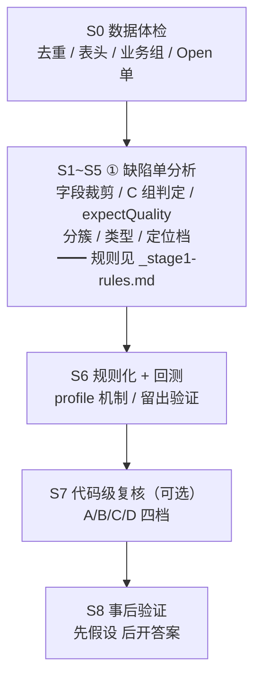

# 缺陷单分析方法论（Playbook）

> 来源：四条产品线完整实战（`hc` / `配套-交通项目` / `led-客户端` / `hcp`）。
> 适用：拿到一批缺陷导出（Excel）+（可选）目标仓库，要在**不改码**的前提下回答「这些缺陷我能做到哪一步」。

## 文档权威性（先读这一节，避免引错数）

同一件事只允许有一个出处。**冲突时以左列为准**：

| 内容 | 唯一权威 | 本文件的位置 |
|---|---|---|
| **① 缺陷单分析的全部规则与实现**（字段裁剪 / C 组判定 / expectQuality / 分簇 / 类型 / 定位档 / 置信度 / profile 开关 / 四条线实测数） | **`_stage1-rules.md`** | §1 只留**方法论与踩坑理由**，条数/规则细节一律指向它 |
| ② 代码级复核、③ 补信息推演、S8 事后验证的**结论与数字** | 各产品线报告 `{hc,配套-交通项目,led-客户端,hcp}.md` | 只给跨线对照 |
| 跨阶段**口径阶梯**、**十六个坑**、**产品线差异配置表**、交付物/验收清单 | **本文件** | — |
| 单条缺陷的落点/改动/缺口 | `规则提取/{产品线}/tier3-*.csv` | — |
| 驱动缺陷单改革（模板改什么、增益、验证方式） | `_defect-ticket-reform.md` | ⚠️ 本文件与 `_stage1-rules.md` **都不含改革建议**，只在结论里引用它 |

> ⚠️ 历史冲突已修：本文件旧版把 `Delay原因` 列入「禁用闭环字段」，
> 但 hcp 实测 25 条全是 `A bug`（已知 bug 延期），**不是**不可修信号 → 现按 `_stage1-rules.md` 列为**可用字段**。

---

## 0. 先记住这条阶梯（所有数字都挂在它上面）

以 **hcp 159 条功能缺陷**（安全单已剔除）为标尺：

```
①-a(L1) 代码/文案级锚点   hcp 9（4.3%）· hc 9（3.0%）· 配套 8（4.0%）· led 8（2.5%）· hitools 112（17.6%）
  ↓ 放宽到「提到具体界面/参数」
①-a(L2) 宽松               hcp 92.3% · hc 83.3% · 配套 79.5% · led 96.6% · hitools 97.5%
  ↓ 期望唯一（expectQuality ∈ {explicit, inferred}）
①-b(L1) 严格可修+可定位    hcp 5（2.4%）· hc 4（1.3%）· 配套 3（1.5%）· led 5（1.6%）· hitools 92（14.5%）
①-b(L2) 宽松               hcp 61.7% · hc 50.7% · 配套 33.0% · led 69.3% · hitools 79.1%
  ↓ + 代码仓（静态）／ + 环境与补信息
② 能力 / ③ 交付           见各产品线文档
── 交叉验证 ──
S8 事后验证           68（42.8%，已剔除 30 条噪音提交假阳性；见坑 12）
```

**四个口径不可混用**。对外报数必须说清是哪一个：

| 口径 | 判据 | 常见值 | 虚高原因 |
|---|---|---|---|
| **①-a 可定位** | 缺陷单能否支撑一次定位 | 85~98% | 只要标题有对象就算，**不校验期望** |
| **①-b 严格可修** | ①-a **且** 期望唯一 | 34~69% | — |
| **② 能力** | 能定位 **且** 能写出确定改动 | 47~65% | 快照若是修复后代码会虚高 |
| **③ 交付** | 改完现象真的消失 | ≤② | 无验证闭环时不可得 |

> **①-a 的准确语义是「没被已知的 8 类不可定位模式拦下」，不是「我证明了能定位」**——
> 86~98% 的单子走 `default` 放行。详见 `_stage1-rules.md` §已知缺陷。

---

## 1. 流水线（S0–S8）



### S0 数据体检（15 分钟，必做）

| 检查 | 命令/方法 | 会踩到的坑（真实案例） |
|---|---|---|
| 文件去重 | `md5sum`；按 `缺陷ID` 交集 | `hc1..hc4` 四个文件是**同一批 50 条**；配套**文件 3 ≡ 文件 4** |
| 行数 vs 唯一 ID | 逐文件统计 | 250 行 → 200 条唯一 |
| 表头一致性 | 逐文件比对列名 | 两产品线 schema 完全不同（65 列 vs 111 列），不能复用字段名 |
| 业务组切分 | `缺陷所属部门` / `申请人所属部门` | hc 早期 200 条**混了 app/硬件/HPP/AX PRO**，得出「AI-Agent 占 42%」是样本污染 |
| **`Open` 单有无** | 统计状态分布 | 配套 200 条 **0 条 Open** → 无法反推「创建时刻哪些字段是空的」 |

**产出**：`样本盘点表`（唯一数、状态、严重级别、质量特性、轮次、时间跨度、空列数、分簇基数）。

**检查点**：能否一句话说出「这是哪个产品线、哪个业务组、什么版本、哪个轮次」？说不出来就是切分没过关。

### S1 字段裁剪 / S2 分簇 / S3 逐条判定 / S4 类型 / S5 定位档

**规则细节（含逐条判据、正则、profile 开关、四条线实测）全部在 `_stage1-rules.md`。**
这里只留**方法层面的三条**，它们是任何新产品线都要重新验一遍的：

| 方法 | 做法 | 为什么不能照抄 |
|---|---|---|
| **字段遍历法** | `字段填充率 × 值域基数 × 是否闭环后才写` 三纬度过一遍，不要凭字段名猜 | 同名字段在不同产品线含义相反：`Delay原因` 在 hcp 是 `A bug`（可用），在别处可能是「不可修」 |
| **分簇键逐线实测** | 拿 4~5 个候选键各跑一遍，看簇数与最大簇占比 | 不可互换：hcp 标题前缀 9 簇（最大 24.5%）· hc 48 簇（12.5%）· 配套 `测试模块` 24 簇 · led `所属模块` 8 簇（38.6%） |
| **留出验证** | 规则在子集上定型后，**先跑剩余未见数据，不改规则** | hc 首跑未见 150 条只有 **89.3%**（16 条失误），修完 100%——但那时 150 条也变成调参集了 |

> 只报「训练集一致率」= 自欺。必须有一个「首次未见数据」的读数。

**已知无法规则化的三处**（不要试图用正则解决）：
- `需求变更` 冒充 `缺陷`（配套 #164 判「可修-逻辑」，`解决方法` 实为「【新需求】同步新需求」）
- 「配置明细/结果明细与实际不符」算不算 AI 行为（取决于「根因算不算模型输出」，hc 约 10 条）
- 「逻辑 ↔ 权限与数据」并存的缺陷（归属取决于实际改哪一处）

### S7 代码级复核（有仓库时强烈建议）

把「可修」拆成四档：

| 档 | 判据 | 口诀 |
|---|---|---|
| **A 有把握** | 改动类型确定：词条/校验/默认值/显隐/枚举/位置层级/对象引用/disabled/缺参 | 「不跑也能判断改对没改对」 |
| **B 需补信息** | 落点确定，正确值在代码之外 | 「知道在哪，不知道填多少」 |
| **C 需运行复现** | 正确性依赖运行时事实 | 「知道该调什么，不知道调了有没有效」 |
| **D 无法** | 前端无权改 / 没法定 | 「设备侧 / CVE / 不可断言 / 需求未定」 |

**关键**：B 与 C 的边界是**「缺事实」还是**「缺观察」**——事实可脱离运行拿到（问产品 / 看设计稿 / 读服务端模板），观察必须跑起来（竞态 / 返回码 / 时序）。
hcp 实测印证：③ 阶段 **B 救 70%、C 只救 40%**。

**产物不是比例，是三张表**（见 `规则提取/hcp/tier3-*.csv`）：

| 表 | 内容 | 为什么必须有 |
|---|---|---|
| 落点表 + 改动表 | `文件:行` + `现有代码` + `改成什么` | 三样缺一不算 A。只报「A 99 条」是无法核查的判读结论 |
| 缺口表 | `缺的类别 → 需要什么 → 为什么缺` | 才能算 ③ 的增益（缺什么 → 谁能补 → 补了值多少） |
| 分档底表 | 逐条 A/B/C/D + S8 列 | 抽样外推要能被复算 |

### S8 事后验证（先假设，后开答案）

```
1. 只读快照 → 写改动假设（文件:行 + 改法），落盘冻结
2. 才去 git log -S <具体符号> / 读「解决方法」字段
3. 记三个指标：根因一致 / 落点一致 / patch 一致
```

**实测（配套 8 条非污染）**：根因/落点一致 **6/7（86%）**，patch 完全一致 **0/8（0%）**。

> **验收标准只能是「现象消失」，不能是「patch 相同」**。同一处缺陷至少有 3 种等价改法，真实提交里还有 `v-show="false"` 硬遮蔽这种反面示范。

#### 变体：拿不到版本历史怎么办（hc 现状）

| 情形 | 配套 | hc |
|---|---|---|
| 仓库来源 | 内部仓，有 `.git` | **无权限，用户手工拷贝快照**，无 `.git` |
| S8 | ✅ 可做（8 条非污染验证） | ⚠️ **可得但不可靠**：20 子仓已初始化，但只有 5 个 HEAD 到 10-09；自动精度 44%、真下界 6% |

**降级三原则**（S8 不可得时）：
1. **同族一致性** —— 同簇 N 条缺陷是否指向同一落点（只能证一致，不能证正确）
2. **代码自证** —— 必须指出「缺失分支/未初始化变量/漏加条件」，不接受「看起来可疑」
3. **交叉自证** —— 两条独立缺陷指向同一函数则互为旁证（同源缺陷不算独立）

**同时必须做的两件事**：
- **快照缺口登记** —— 功能词在快照里 0 命中时，判「快照不含该功能」，**不得**判「缺陷不成立」
  > ⚠️ hc 旧版曾据此判「5 个前缀 / 24 条快照缺功能」，**已被推翻**（那是变更分支名）。登记前先确认「同名 ≠ 同源」
- **对外报数注明置信度** —— 未经外部校验的 A/B/C/D 不能与配套同等级引用

**恢复可验证性的最小条件**：拷贝时带上 `.git`（`--depth=200` 即可），且尽量取**缺陷提出前的月份**。

---

## 2. 定位链路（有代码时）

| 链路 | 做法 | 实例 |
|---|---|---|
| ① 文案 → key → 组件 | i18n 中文 → key → `grep` key | 反馈屏 → `screenNum` → `parkSpeed.js` |
| ② 功能名 → 目录语义 | 目录按功能切时最有效 | 场景调试 → `RapidConfig/view/index/rapidSceneDebugger/` |
| ③ 设备参数名 → 能力集组件 | 参数由 `type/optionName` 驱动渲染 | 增强级别 → `applyServicesystem.vue` |

**前提 1**：定位前先确认快照是「修前状态」（用某个后续才引入的符号做校验，如 `optionNameItem` 计数为 0）。

**前提 2（led 血泪教训）：先确认「子目录是不是独立 git 仓」。**
在父目录跑 `git rev-parse` 失败 ≠ 没历史。`led/` 下 `calibrationtool/` 与 `calibration-subsystem/` 各自是独立仓（1006 + 661 commits），
初版误判成「无 git」直接把 S8 判死。

**前提 3（基线择时）：基线不能取「缺陷批次开始前」，要取「缺陷引入之后、修复之前」。**
反例：led `#1102128`，缺陷期 05-11~06-15，但根因是 05-11 之后的一次**重构**（`resolveUniformSwitchState` → `resolveSendCardSwitchState`，转换函数里丢了取反）。
用 05-11 基线去看代码是**正确的**，只能判「需复现」；真实修复只加了一个 `!`。

应对：
1. 能确定单条缺陷提出日 → `git rev-list -1 --before=<该日>` 取该条专属基线
2. 只能取批次基线时，**必须再查该文件在基线后是否被改过**：`git log --oneline <base>..HEAD -- <file>`
3. 改过 → 该条基线结论降级为「需复现」，不得直接标 A

---

## 3. 十六个坑（全部真实踩过）

| # | 坑 | 教训 |
|---|---|---|
| 1 | **样本污染** | 混合业务组会得出完全相反的结论（hc「AI-Agent 42%」→ 真实 0%）。先切业务组，再谈比例 |
| 2 | **反向证据** | `缺陷处理说明` 的截图是修复后状态，用它判会得出「缺陷不成立」 |
| 3 | **预期结果段当现象** | 模板话术会让可修缺陷被判「不可断言」 |
| 4 | **端侧修饰拆簇** | 同一根因被拆成多簇 → 重复发单 |
| 5 | **「接口」歧义** | 既可指 ISAPI 节点（设备侧），也可指界面控件（前端）。必须靠**协议字段名共现**才判设备侧 |
| 6 | **「无插件」歧义** | 一个产品线是产品设计（不可修），另一个是测试矩阵维度（可修） |
| 7 | **空模板 ≠ 不可断言** | 实际结果为空但标题自足的有 21/22 条，直接判死会误杀 |
| 8 | **训练集当泛化** | 同批回测 100% 毫无意义 |
| 9 | **严重级别排优先级** | `高` 级全是 CVE，业务缺陷全在 `中/低` |
| 10 | **需求变更冒充缺陷** | 配套 #164 判「可修-逻辑」，`解决方法` 实为「【新需求】同步新需求」。**文本判不出 bug vs 需求变更** |
| 11 | **把「可定位」当成「可修复」** | `verdict` 只看「能不能定位」，不看「知不知道改成什么」。hcp 实测：可定位 **96.9%**，但期望唯一只有 78.6%，能写出确定改动 **67.3%**。**差值 30pt 全是「期望不唯一」**（方向不唯一/目标值不唯一/基准不唯一/资源不唯一）。见 §0 四口径 |
| 12 | **S8 的假阳性被当成命中** | 不加 commit 语义过滤的 3-gram 匹配会把「骨架屏 / 合并模块 / upload lan files / 需求开发」类大范围提交算成命中。hcp 实测：98 条命中里 **30 条（18.9%）是假阳性**，「D 档零假阳性」的判断被推翻（D 的 4 条命中全是 `合并智能模块` / `骨架屏`）。**真实下界 61.6% → 42.8%**。教训：S8 报数前必须先按 subject + diff 范围过滤噪音提交，且**只能当下界用** |
| 13 | **关键词检索定位不可用** | 缺陷单是「测试语言」，代码是「工程语言」，两者唯一交集是**修复后写的中文注释**（用它定位 = 用答案判题）。hcp 自动定位器在 6 条有 ground truth 的 A 档上 top-1 文件 **0/6**、top-3 **2/6**。② 的定位不可自动化 |
| 14 | **批次提交让文件级归因失效** | hcp 窗口内 45 个命中 commit 里只有 3 个是单一目的提交，其余一次改 6 文件 520 行覆盖多条缺陷 → 3-gram 只能认出其中一两条。**精确归因必须到 hunk 级**，这是 ② 不可规则化的根本原因 |
| 15 | **只看工作区 `HEAD`，不看分支 → 误判「S8 不可得」** | hc 实测：按 `HEAD` 索引时 20 个子仓只有 5 个跑到 10-09，据此判「历史不足」。改看 `--all` 后每个子仓本地都有 30~124 个分支、最新提交到 **2026-10-28**，窗口内提交 **390 → 699（+309）**，高置信命中 **27 → 54 条**。三种口径还互不相同：超项目记录的 gitlink（HCBEvent 2025-01-21）· 工作区 HEAD（10-09）· `--all`（10-27）。**主仓+N 子模块的仓，先 `git branch -a` 与 `git log --all` 再谈 S8** |
| 16 | **同一修复在多个分支重复落地** | hc「SADP 广播设备提示成 Camera」在 `c0b3ceb0`（HEAD 分支）与 `f8b38305`（另一分支）各有一版改动。单分支索引会漏，且多分支索引会把同一改动算两次。去重指纹：`(模块, 改动文件的 diff 特征串)`，不是 commit sha |
| 17 | **描述贴错：整段抄了另一条用例** | led 11 条作废单里有 2 条，标题是「OSD 显示 IP 与序列号与设计不符」，描述却是「验证手动模式下输入超出 CIE 范围的色坐标」。与坑 8「实际段复读标题」不是同一个洞：**复读还能靠『与标题雷同』识别，异题则完全自洽**，① 侧无法拦，只能靠「标题 vs 描述实词交集」体检。附带结论：**11/11 条作废单全被判 FIXABLE**（7 条还判「严格可修」）→ 规则对「后来被作废」零区分力，但**剔掉后 ①-a/①-b 只动 0.1pt**，分母怎么选不影响结论 |

---

## 4. 产品线差异配置表（新增产品线时按此填）

**规则的唯一出处是 `_stage1-rules.md`；本表只记「差异事实」，供新线对照填写。**

| 维度 | hcp | hc | 配套-交通项目 | led-客户端 | **hitools** | 新线填什么 |
|---|---|---|---|---|---|
| 原始条数 / 剔除后分母 | **212 / 209**（1029 重导出，安全单仅 3；旧 246/159） | **300** / **300**（1029 重导出；旧 200 是其子集） | 200 / 200 | 319 / 319 | **660 / 636**（剔 24 安全） | 有无需前置剔除的池 |
| 列数 | **69** | **69** | 111 | 65 | 不能复用字段名 |
| `Open` 单 | **20**（1029 新增） | 16 | **0** | **0** | **有 Open 才能证明哪些字段是事后回填**；建议每批都保留 Open |
| 两段俱全 | **59.9%**（旧 41.9%） | **68.7%**（旧 65.5%） | 69.5% | 90.3% | 描述质量基线 |
| 实际段有增量 | **6.3%** | 8% | — | 高 | 「实际段=标题复制」比例 |
| 分簇键 | **`测试模块` 14 簇（13 真模块，最大 33%）**（旧：标题前缀 9 簇） | 标题前缀 48 簇 → **`测试模块` 52 簇**（更准） | `测试模块` 24 簇 | ~~`所属模块` 8 簇~~ **作废** → 退回标题前缀（LED 无 `测试模块` 列） | **只能用创建时字段**；`所属模块` 关单时才填 → **完全不读** |
| 最大簇占比 | **33.0%**（top2 合占 63%） | 11.0% | — | 96.9%（309/319） | 分散 vs 集中；hcp 两簇吃掉六成 → 按簇派活合并收益低 |
| 待禁用 NOTCODE | 无需前置剔池（安全单 87→**3**，C7 已兜住） | **禁用 `plugin` + `browser`**（2026-10-29 改：无插件导出在落地） | 禁用 `plugin` + 新增「交互建议」 | 禁用 `service-down` + 新增「驱动」 | 逐条验 |
| 待关闭类型 | 待建 profile | 无 | `兼容性` `权限与数据` | 同上 | 0 条则关 |
| SCA 触发 | `[安全]` + SCA-CVE | 扫描器 + CVE | 扫描器 + CVE/**HIK-VUL** | — | 漏洞编号形态 |
| ①-a 可定位 | **97.6%**（209） | **97.3%**（300） | **88.5%** | 98.1% | **99.7%（634）** | 见坑 11，别叫可修率 |
| ①-b 严格可修 | **62.7%（131）** | **52.7%（158）** | **35.5%（71）** | 69.3%（221） | **79.1%（503）** | — |
| ①-a↔①-b 落差 | 34.9pt | 44.6pt | 53.0pt | 28.8pt | **20.6pt** | 落差越大，单子越「能定位但不知道改成什么」 |
| D1 定位档 | 1.9% | 6.7% | 12.5% | 4.7% | **10.5%**（代码标识符+提示语） | >10% 说明单子里带真技术锚点 |
| 分簇是否可用 | 13 个模块，最大 33% | 52 个模块，最大 11% | 12 个模块，最大 16.5% | 退回标题前缀（无 `测试模块` 列） | **15 个功能模块，最大 66.7%** | `测试模块` = 功能模块，一律可用；>50% 的簇做二级分组 |
| ①-a 实测含量（原样锚点） | — | — | — | **4.1%（13/319）** | 单子里含「基线里原样存在的 ≥6 字中文串」才算；这是唯一可复算的 ①-a 含量指标 |
| ② A 档 | 65.4%（保守 52.3%） | **作废待重做**（v1 用了修复后快照） | 48.5% | **23.3%（纯盲证 10%）** | 三样缺一不算 A；目录级/文件级不算 A |
| ③ A+B（补信息） | 78.0% | ~60% | 79% | **70.0%** | 补的是「事实」不是「观察」 |
| S8 | 原始 61.6% → **42.8%**（下界） | 可得但不可靠：**必须用 `--all` 索引**（HEAD 会漏 44%）；高置信 27%，精度 35%，真下界 **9.5%** | 8 条 | **20%（6/30 逐条复核）** | 先 `--all` + 剔噪音 + **人工复核 30 条**，再谈精度 |
| ②↔S8 | ❌ 差 22.6pt | — | — | ✅ 差 3.3pt（23.3 vs 20） | 两条线在 led 上收敛：**S8 命中的 6 条全部落在 A 档**，A 档之外 0 命中 |
| 代码结构 | 主仓 + 55 子模块（46 已初始化） | 主仓 + **20 子模块（已初始化，5 个到 10-09）** | 单仓 git | 双仓 git | 先确认子目录是否独立仓 + 各自 HEAD 日期 |

---

## 5. 交付物清单

```
docs/defect-input-analysis/
├── _pipeline.md                    ← 本文件：口径阶梯 / 流水线 / 十四坑 / 差异表 / 交付清单
├── _stage1-rules.md                ← ★ ① 缺陷单分析的唯一权威（规则 + 实现 + 四条线实测）
├── _defect-ticket-reform.md        ← ★ 驱动缺陷单改革：改什么 / 值多少 / 怎么验（模板 v2）
├── _known-input-gaps.md            ← 跨产品线输入缺口（GAP-1..8）
├── {产品线}.md                     ← ②③ 结论 + 逐条判定附录
├── {产品线}-代码级复核.md          ← 四档把握度 + 事后验证
├── hc-代码级复核-v2.md             ← hc 正确基线重做（S8 首次可行 + 12 条 verified 落点；取代 v1 的 ②/S8）
└── {产品线}-流程执行记录.md        ← S0–S8 逐步实测

规则提取/
├── _common.md                      ← 跨产品线公共规则
└── {产品线}/
    ├── rules.md                    ← 规则集（含「被数据推翻的禁止规则」）
    ├── evidence.md                 ← 每条规则的行号级证据
    ├── tier2-classification.csv    ← 逐条 A/B/C/D 分档（② 的底表）
    ├── tier3-locate.csv            ← 落点表 + 改动表（只写有证据的）
    ├── tier3-gaps.csv              ← 缺口表（缺的类别 / 需要什么 / 为什么缺）
    ├── tier3-method.md             ← ② 怎么做的 + 失败实验（含自动定位器证否）
    ├── expect-quality.md           ← expectQuality 实测与校准
    ├── s8-crosscheck.csv           ← S8 逐条对账（含噪音假阳性标记）
    ├── baseline-labels.csv         ← 人工判定基线
    ├── fixtures/defects.json       ← 输入样本
    └── check-consistency.ts        ← 一键跑一致率

src/defects/                        ← ① 的可执行实现（1250 行，纯函数无 IO）
├── profile.ts                      ← 产品线差异（唯一允许分叉的地方，18 个开关）
├── fields.ts                       ← A 组：字段裁剪
├── verdict.ts                      ← C 组：C1a~e/C2/C3/C3b/C4/C5/C7 + expectQuality
├── tag.ts                          ← B 组：分簇
├── taxonomy.ts                     ← E 组：类型
├── locate.ts                       ← D/F 组：定位档 + 置信度
└── index.ts                        ← 编排 + 汇总
```

---

## 6. 完工检查清单

```
□ 去重后的唯一条数说得出（不是文件行数）
□ 业务组切分验证过（不是混合样本）
□ 闭环字段全部禁用，且「反向证据」单独列出
□ 分簇键在本产品线实测覆盖 100%
□ 判定顺序固化，且能举出每条规则的行号证据
□ 有一批「首次未见数据」的泛化读数（不是同批回测）
□ 与被数据推翻的规则都被显式记录（不是悄悄改）
□ 代码级复核区分了 A/B/C/D，且 B 与 C 的边界说清了
□ 事后验证是「先写假设再开答案」，且记录 patch 一致率（用于说明不能当标准）
□ 对外报数时标明口径（①-a 可定位 / ①-b 严格可修 / ② 能力 / ③ 交付）
□ 报 ① 时同时报 `strictFixable`（期望唯一），不能只报 `FIXABLE`
□ 报 S8 前已剔除「骨架屏/合并模块/需求开发」类噪音提交，且声明是下界
□ ② 的 A 档有落点表（文件:行 + 现有代码 + 改成什么），不是只报一个比例
□ 缺口的分类是「缺事实（B）」还是「缺观察（C）」，不是「难/易」
□ 报出的缺口已能直接进 `_defect-ticket-reform.md` 的对应必填项（不是「描述不清」这种废话）
```

---

## 7. 一句话总结

> 缺陷单分析不是「算一个百分比」，而是**一条逐级挤水分的流水线**：
> 「信息够不够判」→「期望唯不唯一」→「代码能不能给出唯一下手点」→「改完现象消不消失」。
> 每级削掉的是**不同的东西**：①-a→①-b 削的是「目标无歧义」，①-b→② 削的是「落点无歧义」，②→③ 削的是「运行时可观察」。
>
> **对外只报最高那个一定错。** 而报中间那个（比如只报 `FIXABLE` 95%）同样错——
> 它测的是「没被黑名单拦下」，不是「能定位」。
