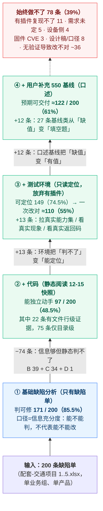

# 配套-交通项目 · 代码级可修复性复核报告

| 项 | 内容 |
|---|---|
| 复核对象 | 200 条唯一缺陷（`配套-交通项目1..5.xlsx`，文件 3 ≡ 文件 4） |
| 代码基线 | `transport` @ `36172d58c`（2025-12-15 19:06）→ 快照 `_snap-20251215/`（1400 文件 / 69MB） |
| 复核方式 | 静态代码阅读 + 三条定位链路；**判定不看修复提交**，提交仅用于 §11 事后验证 |
| 验收口径 | **不看 patch 是否与原作者相同**。「有把握」= 能定位到正确落点 + 能写出让现象消失的改动 |
| 关联文档 | 方法论 [`_pipeline.md`](_pipeline.md) · 前置分析 [`配套-交通项目.md`](配套-交通项目.md) · 规则 [`规则提取/配套-交通项目/`](../../规则提取/配套-交通项目/) |

**结论一句话**：缺陷单能判出 **85.5%** 可修，但那只代表「信息够」。只用缺陷单 + 静态代码，有把握独立做完的是 **48.5%**。加上测试环境（只读定位、放弃有插件）能到 **55%**，再加你口述的 550 基线到 **61%**。

> **若再加「缺陷单补全」（图片 550 对照 / 录屏 / 具体数值 / 日志），到 ≈79%（158/200）**——见 **§13**。这是本产品线唯一能上到 79% 的路径，且 **46pt 里有 30.9pt 靠补信息**，不靠模型能力。

> 本报告有两个口径，不要混：
> - **能力口径**（能不能定位 / 能不能改出来）：48.5% → 68.0% → 85.5%
> - **交付口径**（无验证闭环，一次改对且现象消失）：48.5% → **55%** → **61%**
> 差距 24pt 全部来自「改完没人验，不能收敛」。详见下方「能力阶梯（自下而上）」。

---

## 摘要

### 四档结果

| 档 | 定义 | 条数 | 占比 |
|---|---|---|---|
| **A 有把握** | 只看缺陷单 + 静态代码就能写出确定改动 | **97** | **48.5%** |
| **B 需补信息** | 定位到了，改法取决于外部事实 | **39** | 19.5% |
| **C 需运行复现** | 静态判不了，必须实际渲染或下发 | **34** | 17.0% |
| **D 无法** | 前端改不了或没法定 | **30** | 15.0% |

### 能力阶梯（自下而上）

> **口径提醒**：第 ① 层是「信息充分度」（信息够不够判），第 ②~④ 层是「预期可交付率」（改完现象消失的比例）。
> 两者口径不同，所以 ①→② 是**下降**，不是能力退化 —— 它挤掉了「信息够但做不了」的水分。



> 上面的流程图与第 ④ 层止步于「口述基线＝61%」。**若再加「环境可访问 ＋ 缺陷单补全」，到 ≈79%（158/200）** —— 完整推演见 **§13**，那一步的 41 条残余也从「39%」降到「21%」。

| 层 | 新增能力 | 判可修 / 可定位 | **预期可交付** | 增量 | 该层的真实含义 |
|---|---|---|---|---|---|
| ① 基础缺陷分析 | 只读缺陷单（标题/描述/测试侧字段） | 171（85.5%） | — | — | **信息充分度**，不是修复率 |
| ② + 代码 | 静态读 12-15 快照，逐条定位 | 97（48.5%）可动手 | **97（48.5%）** | ①→② −74 | **今天就能做**；口径切换点 |
| ③ + 测试环境 | 只读设备：拉能力集、看真实现象、看返回码 | 149（74.5%） | **≈110（55%）** | +13 | 定位变准，但**无验证闭环** |
| ④ + 补充信息 | 用户口述 550 基线值 | 149（74.5%） | **≈122（61%）** | +12 | 基线类变填空题 |
| **⑤ + 环境可访问 & 缺陷单补全** | 550 对照截图 + 具体数值 + 现象录屏 + 返回码日志 + 红框标注 | **~180（90%）** | **≈158（79%）** | +36 | **天花板路径**；见 **§13** |

### 为什么 ③ 只到 55%（可定位 74.5% 却掉 19pt）

| 损失来源 | 影响 |
|---|---|
| **无验证闭环** | 渲染/时序类（C 档 23 条）一次改对率仅 55%；改对了不确定对，改错了没机会再试 |
| **有插件模式放弃** | 直接丢 11 条 |
| **12 条要产品拍板** | 「提示该写什么」「示意图画什么」环境给不了 |
| **定位对 ≠ 改法对** | 8 条实测：根因 6/7 对，patch 0/8 相同；等价改法可交付，但仍有改偏（#164） |

### 判定一致性


| | A | B | C | D |
|---|---|---|---|---|
| 初判可修 171 | 97 | 39 | 34 | **1** |
| 初判不可修 29 | 0 | 0 | 0 | **29** |

**170/171 + 29/29 一致**。唯一的翻转是 **#164**：文本判定为「可修-逻辑」，代码 + `解决方法`（「【新需求】同步新需求」）证实是**需求变更**，应归 D。
即：**文本判定能分清「能做 / 不能做」，但分不清「bug / 需求变更」——后者必须看代码或看处理结论。**

---

## 1. 复核方法

### 1.1 为什么基线用 12-15 而不是 12-24

缺陷单最早一批是 **2025-12-18** 提出，而 `12-18 ~ 12-24` 仓库里已有 **20+ 个修复提交**。若用 12-24 快照，这批缺陷在代码里已「提前修好」，复核会系统性失真。

已校验快照确为修前状态：`applyServicesystem.vue` 里 `optionNameItem` 计数 = **0**，而修复提交 `1dce3c70c`（12-18）才引入它。

快照用 `git archive` 导出，**未改动工作区**（`transport` 仍在 master 最新状态）。

### 1.2 三条定位链路（都可复现）

| 链路 | 做法 | 实例 |
|---|---|---|
| ① 文案 → key → 组件 | 在 `Common/static/i18n/zh_CN/*.json`（5874 条）按中文查 key，再 grep key | 反馈屏 → `screenNum` → `parkSpeed.js` |
| ② 功能名 → 目录语义 | 目录名与缺陷用词几乎一一对应 | 场景调试 → `RapidConfig/view/index/rapidSceneDebugger/` |
| ③ 设备参数名 → 能力集组件 | 参数由 `oParamsInfo.type/optionName` 驱动渲染 | 增强级别 → `applyServicesystem.vue` |

链路②尤其有效，因为该仓库目录是按功能切的：

```
src/RapidConfig/view/index/rapid{BasicParam,OSDConfig,LaneLine,SceneDebugger,UploadConfig,TriggerMode}/
src/Config/view/snap/triggerMode/{videoEpolice,postHVT,postRadar,postRS485,parkSpeedDetection,faceDetect,TPS,PostPRS}/
src/Config/view/snap/snapParam/{snapOverlay,illegalDictionary,lightControl,plateParam,regionClip}/
src/Config/view/snap/snapAdvance/{applyServicesystem,applyServiceimage}/
src/Config/view/video/{videoParam,videoCode,videoTextOverlay,videoPip}/
src/Radar/{service/radarMixin.js,components/radarGPS,components/radarModel,view/index}/
```

### 1.3 四档的判定标准

| 档 | 判据 |
|---|---|
| **A** | 改动类型是**确定的一类**：词条、校验、默认值、显隐条件、枚举缺项、位置/层级、对象引用、`disabled` 条件、缺参 —— 不跑也能判断改对没改对 |
| **B** | 落点确定，但**正确值不在代码里**：550 基线阈值、机型能力集、设计稿、产品口径。含「知道缺一个提示控件，但不知道提示该写什么」 |
| **C** | 正确性依赖**运行时事实**：渲染时序、插件生命周期、播放/解密状态、下发回执、概率问题 |
| **D** | 前端**无权改**或**没法定**：ISAPI 节点缺失（设备侧）、CVE（依赖升级）、描述不可断言、需求未定 |

### 1.4 怎么避免「用答案判题」

A/B/C/D 的判断全部来自「缺陷单文本 + 快照代码」，**不看修复 diff**。git 只用于三件事：确认快照是修前状态、§11 事后验证、以及读取 `解决方法` 字段做旁证。

---

## 2. 总结果

### 2.1 按类型 × 档

| 类型 | 总 | A | B | C | D |
|---|---|---|---|---|---|
| 逻辑 | 124 | 50 | 34 | 33 | 7 |
| UI还原度 | 40 | 25 | 3 | 0 | 12 |
| 文案与配置 | 24 | 21 | 2 | 1 | 0 |
| 安全 | 12 | 1 | 0 | 0 | 11 |

**读法**：

- **文案与配置 A 率 88%** —— i18n 最容易做，但也是价值最低的一类（改词条）
- **UI还原度 D 率 30%** —— 8 条「显示异常/问题汇总」不可断言 + 需求未定都落在 UI
- **逻辑类 A 率 40%** —— 难的不是逻辑，是逻辑背后的基线值与运行时状态

### 2.2 A 档 97 条的改动类型

| 改动类型 | 条数 |
|---|---|
| 控件逻辑修正 | 22 |
| 布局/样式修正 | 21 |
| 补/改词条（i18n） | 19 |
| 补提示控件/提示逻辑 | 9 |
| 补校验/拦截 | 7 |
| 补默认值/补选项 | 7 |
| 拆分绑定/取值来源 | 5 |
| 交互可用条件修正 | 4 |
| 显隐条件/枚举裁剪 | 2 |
| 补控件（密码可见性） | 1 |

> **49/97（51%）是「词条 + 提示 + 布局」** —— 这类改动确定性最高，最适合先自动化。

---

## 3. 按簇拆解（决定先补哪块）

| 测试模块 | 总 | A 率 | B | C | D | 代码位置 |
|---|---|---|---|---|---|---|
| 抓拍参数 | 33 | **12 (36%)** | 15 | 3 | 3 | `src/Config/view/snap/snapParam/ + triggerMode/` |
| 【专项测试】易用性专项用例 | 28 | **14 (50%)** | 4 | 7 | 3 | `跨：RapidConfig/ + snapParam/snapOverlay/` |
| 应用模式 | 26 | **10 (38%)** | 5 | 7 | 4 | `src/Config/view/snap/triggerMode/{parkSpeedDetection,postHVT,postRadar,videoMonitor,faceDetect,TPS}` |
| 国内-微卡雷达 | 21 | **13 (62%)** | 2 | 6 | 0 | `src/Radar/（radarMixin.js / radarGPS / radarModel / view/index）` |
| 视频 | 16 | **10 (62%)** | 4 | 1 | 1 | `src/Config/view/video/{videoParam,videoCode,videoTextOverlay,videoPip}` |
| 【海外】海外功能 | 13 | **8 (62%)** | 2 | 2 | 1 | `src/RapidConfig/ + Common/static/i18n/` |
| 安全 | 12 | **1 (8%)** | 0 | 0 | 11 | `（第三方依赖 / 固件）` |
| 海外-微卡雷达 | 12 | **8 (67%)** | 2 | 2 | 0 | `src/Radar/` |
| 系统 | 8 | **3 (38%)** | 0 | 0 | 5 | `src/Config/view/system/ + RapidConfig/rapidBasicParam/` |
| 【公共】B1必测项 | 6 | **4 (67%)** | 0 | 1 | 1 | `跨模块` |
| 抓拍 | 5 | **3 (60%)** | 1 | 0 | 1 | `src/Config/view/snap/snapParam/{lightControl,plateParam,regionClip}` |
| 高级参数 | 3 | **2 (67%)** | 0 | 1 | 0 | `src/Config/view/snap/snapAdvance/{applyServicesystem,applyServiceimage}` |
| 控件用例合集 | 2 | **1 (50%)** | 1 | 0 | 0 | `跨模块` |
| 接口测试 | 2 | **2 (100%)** | 0 | 0 | 0 | `src/Config/view/snap/ + 导出逻辑` |
| 人脸侦测 | 2 | **0 (0%)** | 0 | 2 | 0 | `src/Config/view/snap/triggerMode/faceDetect/` |
| 预览 | 2 | **2 (100%)** | 0 | 0 | 0 | `src/Preview/` |
| 出入口 | 2 | **0 (0%)** | 2 | 0 | 0 | `src/Config/view/snap/entrance/ + triggerModeForEntrance/` |
| UI专项测试 | 2 | **1 (50%)** | 1 | 0 | 0 | `跨模块` |
| 【公共】详细用例-系统 | 1 | **0 (0%)** | 0 | 1 | 0 | `src/Config/view/system/` |
| 【公共】详细用例-视频 | 1 | **0 (0%)** | 0 | 1 | 0 | `src/Config/view/video/` |
| 【公共】详细用例-图片 | 1 | **1 (100%)** | 0 | 0 | 0 | `src/Config/view/snap/triggerMode/postHVT/` |
| 登录&激活 | 1 | **1 (100%)** | 0 | 0 | 0 | `src/Portal/view/login/` |
| 系统维护(海外) | 1 | **1 (100%)** | 0 | 0 | 0 | `src/Operations/` |

### 三个反直觉

1. **微卡雷达 33 条 A 率 64%，比预期好得多。**
   原以为「标定/参数下发」都要和硬件交互，读了 `radarMixin.js`（13.8k 行）发现大部分是**单位错误、参数顺序、底图偏大、配置方式未对齐、字号不一致**——全是静态可判的前端问题，真正需要设备的只有 8 条。

2. **抓拍参数 33 条 A 率只有 36%，是最大的坑。**
   其中 **13 条是「与 550 基线不一致」的阈值/范围**——定位到 `triggerMode/videoEpolice/videoEpoliceMixin.js` 没问题，但**正确数值不在这份代码里**。

3. **应用模式 26 条 A 率 38%。**
   7 条在「需运行复现」里，多数是「无插件下未显示车道线/标志线不显示」——`parkSpeedDetection`、`postHvtMixin` 里能看到绘制调用，但为什么不显示必须实机看。

---

## 4. B 档 39 条：缺什么，补了到哪

| 缺什么 | 条数 | 补齐后 |
|---|---|---|
| **缺 550 基线值/口径** | 26 | → A |
| 缺机型能力集数据 | 6 | → A |
| 缺设计稿/正确文案 | 4 | → A |
| 缺产品口径 | 3 | → A |

**26/39 只缺 550 基线**，与前置分析里 `baseline` 缺口高度重合。这是该产品线的**头号外部依赖**，也是最容易补的一类（一张「事件 × 参数 × 基线值」对照表即可）。

典型：

- `#136` 不礼让行人灵敏度 web 阈值与 550 不一致 → 需要 550 的阈值本身
- `#135 #140` 缺提示控件，但**提示该写什么**要产品/基线给
- `#130 #132 #134 #137 #138 #139 #143 #145 #146 #147 #151` 同族共 11 条，全是视频电警事件阈值

补齐后：**48.5% → 68.0%**。

---

## 5. C 档 34 条：为什么静态判不了

| 原因 | 条数 | 代表 |
|---|---|---|
| 渲染/绘制时序，需实机确认 | 17 | #4 · #6 · #23 · #41 |
| 需运行复现 | 7 | #32 · #34 · #54 · #144 |
| 下发/回执，需设备返回码 | 5 | #44 · #53 · #101 · #117 |
| 请求/上传回执，需实机确认 | 3 | #1 · #13 · #177 |
| 播放/状态回显，需实机确认 | 2 | #74 · #109 |

**共同点**：代码能读到「该调的方法」，但「调了没有效」取决于设备返回、插件版本、渲染时序。

### `测试环境` 字段的真实形态（救 C 档的唯一钥匙）

| 形态 | 条数 | 能否直接访问 |
|---|---|---|
| 型号+版本+序列号+**「Web升级测试环境N」**（12 个环境名） | **155** | ❌ 需「环境名 → IP + 账号」映射表，表不在缺陷单里 |
| 裸型号/设备名（`9856-G`、`883设备`） | 25 | ❌ 需设备台账 |
| 制品文件名（`ITS_9796_...zip`） | 10 | ❌ 是安装包 |
| 型号+版本 | 5 | ❌ |
| **含设备 IP** | **1** | ✅（`10.67.36.124`，且那条是漏洞单） |
| 含用户名/密码 | **0** | ❌ |

> 环境名集中在 `Web升级测试环境{1,3,4,6,7,8,9,10,11,12,13}`，其中 **10 号 36 条、7 号 33 条、11 号 16 条**。

**结论**：`测试环境` 在人那里是「已部署、可登录复现」的入口；在**数据层面只是一个环境标签**。要把 C 档 34 条变成可做，前置条件是：

1. 一张 `Web升级测试环境N → IP + 账号/密码` 映射表
2. 内网访问通道

有 → 可做率 **68.0% → 85.5%**；没有 → C 档 34 条属于「改得出、验不了」。

---

## 6. D 档 30 条（不能做）

| 原因 | 条数 | 行号 |
|---|---|---|
| 依赖升级/固件补丁 | 11 | #8 #9 #10 #93 #94 #95 #96 #97 #98 #99 #100 |
| 描述不可断言 | 8 | #40 #57 #63 #65 #150 #166 #167 #174 |
| 需求未定 | 6 | #69 #120 #123 #149 #164 #190 |
| ISAPI 节点缺失（设备侧） | 4 | #152 #155 #156 #157 |
| 实现方式建议 | 1 | #17 |

CVE 那 11 条要注意：**它们占掉了全部 3 条 `高` 严重级别**。若按严重级别排优先级，业务缺陷会被 CVE 挤掉。

---

## 7. 案例库

### 7.1 A 档里有文件行级证据的条目

| 缺陷 | 代码证据 | 改动 |
|---|---|---|
| #153 [系统] iDS-2CD97C6-HMS/16 快速配置海外勾选夏令时时需要 | `rapidBasicParam.vue:232-241 六个 el-select 绑 szStartMonth 等，初始化未赋值 → 补默认值` | 补默认值/补选项 |
| #158 [视频] 视频图像界面，夜间色彩模式缺少提示控件 | `videoParam.vue:738 el-form-item 无 :introduction（同文件其他项都有）→ 补提示` | 补提示控件/提示逻辑 |
| #159 [【专项测试】易用性专项用例] TCM443-GR，快速配置-应用模式页面切 | `应用模式重启提示框 z-index 被预览层盖住` | 补提示控件/提示逻辑 |
| #162 [应用模式] 国内9796无插件的HEMSHVT模式下，缩放到150%时，预 | `150% 下添加车道栏高度未计入布局 → 覆盖下方图` | 布局/样式修正 |
| #165 [【专项测试】易用性专项用例] iDS-TCM443-GR，快速配置-车道配 | `RapidConfig/view/index.vue:134 @click=addLane() :disabled=!visiblePolygon → 查 addLane 被拦条件` | 交互可用条件修正 |
| #169 [应用模式] 国内9796-HEMS的的玩手机缺少提示语 | `postHVT 玩手机事件缺提示词条` | 补提示控件/提示逻辑 |
| #171 [应用模式] 9796HEMS 非限行的省份以及非限行区域没有无 | `province 下拉缺『无』选项` | 控件逻辑修正 |
| #176 [抓拍] 高级参数-系统服务中的增强级别为空，且无选项 | `applyServicesystem.vue option 分支取不到 optionName → 补 option 渲染` | 补默认值/补选项 |
| #178 [应用模式] 国内9796-HM的HVT的事件跟车过近违章的标志线名称错误 | `postHVT 词条 key 用错（跟车过近标志线名称）` | 补/改词条（i18n） |
| #179 [UI专项测试] 海外-快速配置页面设置需要重启生效的接口，比如牌识区域、I | `rapidBasicParam restartXhr 存在，但重启提示未挂到保存回执` | 控件逻辑修正 |
| #181 [应用模式] 国内9796-HM的HVT的事件勾选选择全选无法全部配置下去 | `triggerModePostHVT.vue:2710 checkAll(event) 按 event 循环，bSelectAllAreaChecked 未同步` | 控件逻辑修正 |
| #182 [视频] 国内，ROI命名下发与保存不一致，建议国内海外ROI命名输入框对可 | `roi.vue:77 只有 :maxlength=32，无 rules 校验 → 补校验` | 补校验/拦截 |
| #185 [系统维护(海外)] 98C6HLS从提测版本升级到传统550之后，会返回4 | `index.asp 只有 no-cache meta，资源路径未随版本变 → 加版本号` | 控件逻辑修正 |
| #187 [抓拍] 高级参数-系统服务中的特写图叠加定位框类型为空，且无选项 | `applyServiceimage/applyServicesystem 同类 option 渲染缺失` | 补默认值/补选项 |
| #188 [应用模式] TCM403-GR，园区测速模式初始配置下修改反馈屏1的ip后 | `parkSpeed.js（screenNum）两个反馈屏共用同一 IP 对象 → 拆开` | 拆分绑定/取值来源 |
| #189 [【专项测试】易用性专项用例] 9396HIS,快速配置布防上传界面有云存储 | `rapidUploadConfig 云存储链接地址/跳转逻辑` | 布局/样式修正 |
| #191 [应用模式] TCM403-GR，园区测速模式下反馈屏ip默认为127.0. | `parkSpeed.js IP 校验放行 127.0.0.1 → 补校验` | 补校验/拦截 |
| #192 [应用模式] TCM403-GR，园区测速模式下卡口抓拍不勾选任何类型，点击 | `parkSpeed.js:892 objectSnappingType 读到但未校验空值 → 补拦截` | 控件逻辑修正 |
| #193 [应用模式] TCM403-GR，园区测速模式下复制参数到其他车道，车道线类 | `parkSpeed.js 复制参数遗漏 laneLineType 字段` | 控件逻辑修正 |
| #197 [【专项测试】易用性专项用例] 98C6HLS，抓拍参数字符叠加界面，对预览 | `snapOverlay.vue 抓图触发 resize 重算高度 → 去掉` | 布局/样式修正 |
| #199 [抓拍参数] 海外设备RS485雷达模式下Scene and Mode Co | `triggerModePostRadar.vue 页面归属（Event Settings → Basic Configuration）` | 控件逻辑修正 |
| #200 [【专项测试】易用性专项用例] 98C6HLS，预览界面实时抓图后，图片显示 | `snapOverlay.vue 图片层无销毁时机 → 补` | 布局/样式修正 |

**其余 75 条 A 只到目录级** —— 能确定「改这个模块的这类控件」，没逐行读。这是本报告**最大的不确定来源**（见 §8）。

### 7.2 被代码推翻的初判

**#152 #155 #156 #157「丢失 XXX 接口」→ 设备/协议侧（初判可修-逻辑）**

| 缺陷 | 代码事实 |
|---|---|
| #152 丢失**视频格式**接口 | `rapidBasicParam.vue:22` 有 `el-select v-model="oParams.videoFormat"`，:1173 有能力集 `bSupportVideoStandard` → **UI 在，缺的是 ISAPI 节点** |
| #155 丢失 **PTP 网卡选择**接口 | `networkTab: '0' // 网卡参数tab`（:269）在 → 同上 |
| #156 丢失 **28181 平台索引**接口 | 同上 |
| #157 丢失**卫星校时时间间隔**接口 | `satelliteInterval`（:558）、`oSatelliteCap`（:710）在 → 同上 |

**「接口」在这个域是歧义词**：既能指 ISAPI XML 节点（设备侧），也能指界面控件入口（前端可修）。

| 同用「接口」但属前端问题 | 结论 |
|---|---|
| #107 海外可变车道接口丢失 | 控件显隐 → 可修 |
| #122 坐标标定缺少停止标定接口 | 缺按钮 → 可修 |
| #163 缺选择通道 1/2 的接口 | 缺控件 → 可修 |

**#164「标定模式多了手动标定选项」→ 需求变更（初判可修-逻辑）**
`解决方法` = 「【新需求】同步新需求」，修复提交 `e529ae4f0` 是把 select 从 `wrapper-title` 插槽里挪出来重构，不是"过滤选项"。

所以规则只认**协议字段名共现**的情况（`校时|平台索引|视频格式|网卡|PTP|28181|卫星` + `丢失/缺少…接口` → `DEVICE`），不做泛化。规则库随之更新，配套可修率 87.5% → **85.5%**。

### 7.3 一个方法论收获

真实提交里混入大量**无关格式化**。例：`424ae40c4`（修「卡口抓拍保存」）的 `parkSpeed.js` diff 里大半是 `GetScreenMapData () {` → `GetScreenMapData() {`。

含义：**不能拿真实提交当「正确修复」的示范**，否则会学到一堆与缺陷无关的格式调整。

---

## 8. 局限（必须知道）

| 局限 | 影响 |
|---|---|
| **A 档 97 条里 75 条只到目录级** | A 的真实值可能漂移 **±10 条（±5pt）**。要压实需把这 75 条读到行级 |
| **单次快照** | 只对 `36172d58c` 成立；后续 refactor 会改变落点 |
| **无运行时验证** | A 档只保证「改动类型和落点确定」，不保证「改完真的对」 |
| **单个复核者** | B/C 边界有主观性（「缺提示内容」判 B 还是 A 就是例子：初版误判 2 条，已修） |
| **事后验证只有 8 条** | 见 §11，样本小；且 6 条属「先看过 diff 才确认」，不计入命中率 |

---

## 9. 对产品的结论

1. **判定层已经可用，但要补一类**：可修/不可修与代码事实基本一致（170/171 + 29/29），唯一漏判是「需求变更」（#164）——需要额外的判据（`解决方法` 含【新需求】/`解决结论` 为 Not a bug）。
2. **执行层真实上限是 48.5%**（无外部数据、无运行时）。对外必须区分「信息充分度 85.5%」与「可独立完成 48.5%」。
3. **最高性价比投入是「550 基线表」**：一张表覆盖 26 条（+13.0pt）。
4. **其次是「环境名 → IP/账号」映射**：覆盖 34 条（+17.0pt），也是唯一能突破「改得出验不了」的手段。
5. **不要用严重级别排优先级**：3 条 `高` 全是 CVE，业务缺陷全在 `中/低`。
6. **词条/提示/布局类占 A 档 51%**：最适合第一批自动化的子集（确定性高、风险低、可批量验证）。
7. **验收口径**：不能要求 patch 与原作者一致（实测 0/8 一致但 7/8 根因一致），只能要求「现象消失」。

---

## 10. 附录：200 条逐条

| # | 初判 | 代码级 | 动作 / 缺口 | 类型 | 测试模块 | 代码位置 | 标题 |
|---|---|---|---|---|---|---|---|
| 1 | ✅ | **C** | 请求/上传回执，需实机确认 | 逻辑 | 【公共】详细用例-系统 | `src/Config/view/system/` | [系统] 升级前基线版本开启DN值，升级后web缺少PIN |
| 2 | ✅ | **A** | 控件逻辑修正 | 逻辑 | 视频 | `src/Config/view/video/{videoParam,videoCode,videoTextOverlay,videoPip}` | [视频] 视频图像，日夜切换模块，宽动态设置按时间启用后，设置时间的控件可以把时间清空， |
| 3 | ✅ | **A** | 控件逻辑修正 | 逻辑 | 抓拍参数 | `src/Config/view/snap/snapParam/ + triggerMode/` | [抓拍参数] 视频电警，超速事件，非车道1，设标志限速高于限高速，提示错误后在修改为合法 |
| 4 | ✅ | **C** | 渲染/绘制时序，需实机确认 | 逻辑 | 【公共】详细用例-视频 | `src/Config/view/video/` | [预览]883设备，无插件下，使能 WebSocket端口，预览也失败 |
| 5 | ✅ | **A** | 布局/样式修正 | UI还原度 | 抓拍参数 | `src/Config/view/snap/snapParam/ + triggerMode/` | [抓拍参数] 分辨率150%下，字符叠加界面，叠加全部信息，最下面的显示不全 |
| 6 | ✅ | **C** | 渲染/绘制时序，需实机确认 | 逻辑 | 抓拍参数 | `src/Config/view/snap/snapParam/ + triggerMode/` | [抓拍参数] 有插件/无插件，883快速配置界面，图片配置界面，通道2切换到通道1了，没 |
| 7 | ✅ | **A** | 控件逻辑修正 | 逻辑 | 抓拍参数 | `src/Config/view/snap/snapParam/ + triggerMode/` | [抓拍参数] 有插件/无插件，883快速配置界面，车道配置界面下一步到补光灯参数界面，无 |
| 8 | ❌SCA | **D** | 依赖升级/固件补丁 | 安全 | 安全 | `（第三方依赖 / 固件）` | [安全][软件成分分析]【ITS_9796_HMS_Chip_CN_STD_V5.5.0 |
| 9 | ❌SCA | **D** | 依赖升级/固件补丁 | 安全 | 安全 | `（第三方依赖 / 固件）` | [安全][软件成分分析]【ITS_9396_GS_Chip_CN_STD_V5.5.0_ |
| 10 | ❌SCA | **D** | 依赖升级/固件补丁 | 安全 | 安全 | `（第三方依赖 / 固件）` | [安全][产品漏洞扫描]【禁止备案】HIK-VUL-222_RTSP_Double_Fr |
| 11 | ✅ | **B** | 缺产品口径 | 逻辑 | 控件用例合集 | `跨模块` | [设备状态] 已用内存与实际不符 |
| 12 | ✅ | **A** | 布局/样式修正 | UI还原度 | 【海外】海外功能 | `src/RapidConfig/ + Common/static/i18n/` | [快速配置] 缩放150%，数据采集应用模式-线圈和车道线配置未自适应 |
| 13 | ✅ | **C** | 请求/上传回执，需实机确认 | 逻辑 | 【海外】海外功能 | `src/RapidConfig/ + Common/static/i18n/` | [【导出配置文件】] 导出配置文件时web跳出不是私密连接的提示，需要第二次输入用户名密 |
| 14 | ✅ | **A** | 布局/样式修正 | UI还原度 | 【海外】海外功能 | `src/RapidConfig/ + Common/static/i18n/` | [回放]缩放150%情况下，图片查询-图片遮挡住其他信息，没有自适应 |
| 15 | ✅ | **A** | 补/改词条（i18n） | 文案与配置 | 【海外】海外功能 | `src/RapidConfig/ + Common/static/i18n/` | [预览] 海外英文模式下，预览界面暂停按钮提示中文信息 |
| 16 | ✅ | **A** | 补提示控件/提示逻辑 | 逻辑 | 【海外】海外功能 | `src/RapidConfig/ + Common/static/i18n/` | [快速配置]步骤五图片上传-ISUP 无重启提示信息 |
| 17 | ❌NOTCODE | **D** | 实现方式建议 | 逻辑 | 【海外】海外功能 | `src/RapidConfig/ + Common/static/i18n/` | [快速配置] 步骤五图片上传-集成协议-添加用户密码提示信息建议做在外面显示 |
| 18 | ✅ | **B** | 缺 550 基线值/口径 | 逻辑 | 【海外】海外功能 | `src/RapidConfig/ + Common/static/i18n/` | [快速配置]步骤五图片上传，海外基线不支持RTMP和云存储 |
| 19 | ✅ | **A** | 补提示控件/提示逻辑 | 逻辑 | 【海外】海外功能 | `src/RapidConfig/ + Common/static/i18n/` | [快速配置] 步骤四OSD配置，自定义信息为空时，保存或者下一步，提示信息有两个 |
| 20 | ✅ | **B** | 缺 550 基线值/口径 | 逻辑 | 国内-微卡雷达 | `src/Radar/（radarMixin.js / radarGPS / radarModel / view/index）` | [国内-微卡雷达] 国内微卡对比550快速配置标定页面多出标定状态与重新标定接口 |
| 21 | ✅ | **A** | 拆分绑定/取值来源 | UI还原度 | 国内-微卡雷达 | `src/Radar/（radarMixin.js / radarGPS / radarModel / view/index）` | [国内-微卡雷达] 国内双通道微卡标定状态显示异常，进度条显示不一致应统一 |
| 22 | ✅ | **A** | 布局/样式修正 | UI还原度 | 国内-微卡雷达 | `src/Radar/（radarMixin.js / radarGPS / radarModel / view/index）` | [国内-微卡雷达] 国内微卡强制标定图示信息应修改字体大小与上一个一致 |
| 23 | ✅ | **C** | 渲染/绘制时序，需实机确认 | 逻辑 | 国内-微卡雷达 | `src/Radar/（radarMixin.js / radarGPS / radarModel / view/index）` | [国内-微卡雷达] 国内微卡设备手动标定添加标定点个数，实际预览画面中无第5个点出现，导 |
| 24 | ✅ | **A** | 交互可用条件修正 | 逻辑 | 海外-微卡雷达 | `src/Radar/` | [海外-微卡雷达] 国内雷视微卡设备航向角参数无法通过按钮调节大小 |
| 25 | ✅ | **A** | 补校验/拦截 | 逻辑 | 国内-微卡雷达 | `src/Radar/（radarMixin.js / radarGPS / radarModel / view/index）` | [国内-微卡雷达] 国内微卡设备目标停留时间范围应修改至0-60S |
| 26 | ✅ | **A** | 补/改词条（i18n） | 文案与配置 | 海外-微卡雷达 | `src/Radar/` | [海外-微卡雷达] 海外微卡目标停留时间单位应修改为S |
| 27 | ✅ | **A** | 补默认值/补选项 | 逻辑 | 海外-微卡雷达 | `src/Radar/` | [海外-微卡雷达] 403GR海外雷视微卡雷达页面车道个数从3车道修改至1车道，隔离带原 |
| 28 | ✅ | **A** | 补提示控件/提示逻辑 | 逻辑 | 接口测试 | `src/Config/view/snap/ + 导出逻辑` | [接口测试] 海外特有，交通流量统计界面，获取数据为空时，提示框缺失 |
| 29 | ✅ | **A** | 布局/样式修正 | UI还原度 | 海外-微卡雷达 | `src/Radar/` | [海外-微卡雷达] 海外抓拍机无插件下，雷达界面显示数据与滚动条出现遮挡 |
| 30 | ✅ | **A** | 布局/样式修正 | UI还原度 | 【公共】B1必测项 | `跨模块` | [快速配置]抓拍图叠加，界面存在大量空白 |
| 31 | ✅ | **A** | 补/改词条（i18n） | 文案与配置 | 海外-微卡雷达 | `src/Radar/` | [海外-微卡雷达] 海外微卡雷达页面航向角与灵敏度接口单位错误 |
| 32 | ✅ | **C** | 需运行复现 | 逻辑 | 海外-微卡雷达 | `src/Radar/` | [海外-微卡雷达] 海外微卡修改雷达检测距离，实际底图显示距离未修改 |
| 33 | ✅ | **A** | 补提示控件/提示逻辑 | 逻辑 | 接口测试 | `src/Config/view/snap/ + 导出逻辑` | [接口测试] 海外，交通流量统计界面，起始时间选择相同时，缺失时间限制的提示框 |
| 34 | ✅ | **C** | 需运行复现 | 逻辑 | 【海外】海外功能 | `src/RapidConfig/ + Common/static/i18n/` | [快速配置] 抓拍图叠加，叠加文字语言功能不生效 |
| 35 | ✅ | **A** | 补/改词条（i18n） | 文案与配置 | 【海外】海外功能 | `src/RapidConfig/ + Common/static/i18n/` | [快速配置] 建议自定义OSD信息序号列名称一致 |
| 36 | ✅ | **B** | 缺设计稿/正确文案 | UI还原度 | 海外-微卡雷达 | `src/Radar/` | [海外-微卡雷达] 海外抓拍机雷达标定强制标定无引导示意图需要添加 |
| 37 | ✅ | **B** | 缺产品口径 | 逻辑 | 【海外】海外功能 | `src/RapidConfig/ + Common/static/i18n/` | [快速配置] 快速配置中图片上传 各个界面均不支持云存储，参考http://defect |
| 38 | ✅ | **A** | 补/改词条（i18n） | 文案与配置 | 【专项测试】易用性专项用例 | `跨：RapidConfig/ + snapParam/snapOverlay/` | [【专项测试】易用性专项用例] 繁体中文下，部分界面未翻译 |
| 39 | ✅ | **A** | 补/改词条（i18n） | 文案与配置 | 【海外】海外功能 | `src/RapidConfig/ + Common/static/i18n/` | [数据采集]英文模式步骤一数据上传显示为中文 |
| 40 | ❌VAGUE | **D** | 描述不可断言 | UI还原度 | 【公共】B1必测项 | `跨模块` | [快速配置] 步骤一保存按钮UI异常 |
| 41 | ✅ | **C** | 渲染/绘制时序，需实机确认 | 逻辑 | 人脸侦测 | `src/Config/view/snap/triggerMode/faceDetect/` | [人脸侦测] TCM443-G国内设备，通道1配置人脸侦测模式，通道2为智慧监控模式，2 |
| 42 | ✅ | **A** | 控件逻辑修正 | 逻辑 | 【海外】海外功能 | `src/RapidConfig/ + Common/static/i18n/` | [【海外】海外功能] 【海外】98G6-HIS，快速配置，基本信息，牌识区域设置，第一次 |
| 43 | ✅ | **A** | 布局/样式修正 | UI还原度 | 抓拍参数 | `src/Config/view/snap/snapParam/ + triggerMode/` | [抓拍参数] 分辨率150%下，字符叠加界面，右侧的滚动条显示在最下面，应随表格高度显示 |
| 44 | ✅ | **C** | 下发/回执，需设备返回码 | 逻辑 | 海外-微卡雷达 | `src/Radar/` | [海外-微卡雷达] 海外设备雷达页面手动标定添加标定点后校准，参数无法保存 |
| 45 | ✅ | **A** | 补/改词条（i18n） | 文案与配置 | 海外-微卡雷达 | `src/Radar/` | [海外-微卡雷达] 海外雷达页面显示灵敏度的单位错误，应修改 |
| 46 | ✅ | **A** | 补/改词条（i18n） | 文案与配置 | 预览 | `src/Preview/` | [预览] TCD403-BI海外设备，预览内语音对讲按钮的悬浮title是中文 |
| 47 | ✅ | **A** | 补/改词条（i18n） | 文案与配置 | 【公共】B1必测项 | `跨模块` | [数据采集] 小目标检测区域名称不正确 |
| 48 | ✅ | **A** | 补/改词条（i18n） | 文案与配置 | 海外-微卡雷达 | `src/Radar/` | [海外-微卡雷达] 雷达页面Debug界面下两个速度相关接口，单位错误应修改 |
| 49 | ✅ | **A** | 控件逻辑修正 | 逻辑 | 海外-微卡雷达 | `src/Radar/` | [海外-微卡雷达] 雷达页面参数修改异常值后不保存，点击场景其他焦点，实际接口参数会修改 |
| 50 | ✅ | **B** | 缺 550 基线值/口径 | UI还原度 | 海外-微卡雷达 | `src/Radar/` | [海外-微卡雷达] 雷达页面debug参数栏显示参数顺序与550基线不一致 |
| 51 | ✅ | **A** | 交互可用条件修正 | 逻辑 | 控件用例合集 | `跨模块` | [数据采集] 小目标检测区域应为不能更改大小 |
| 52 | ✅ | **A** | 布局/样式修正 | UI还原度 | 抓拍参数 | `src/Config/view/snap/snapParam/ + triggerMode/` | [抓拍参数] 快速配置界面，抓拍叠加界面有大量空白界面 |
| 53 | ✅ | **C** | 下发/回执，需设备返回码 | 逻辑 | 高级参数 | `src/Config/view/snap/snapAdvance/{applyServicesystem,applyServiceimage}` | [高级参数] 98C6-HELS，高级参数-图像服务，车牌增强一致性接口无法成功下发，保 |
| 54 | ✅ | **C** | 需运行复现 | 逻辑 | 人脸侦测 | `src/Config/view/snap/triggerMode/faceDetect/` | [人脸侦测] 9545GRSZ人脸侦测模式下，快速配置OSD配置，抓拍图叠加配置叠加项内 |
| 55 | ✅ | **A** | 布局/样式修正 | UI还原度 | 抓拍参数 | `src/Config/view/snap/snapParam/ + triggerMode/` | [抓拍参数] 文字识别快速配置界面，osd叠加存在大面积空白 |
| 56 | ✅ | **C** | 渲染/绘制时序，需实机确认 | 逻辑 | 【专项测试】易用性专项用例 | `跨：RapidConfig/ + snapParam/snapOverlay/` | [【专项测试】易用性专项用例] 无插件下布防后抓拍，切换到交通统计会直接显示信息，有插件 |
| 57 | ❌VAGUE | **D** | 描述不可断言 | UI还原度 | 【专项测试】易用性专项用例 | `跨：RapidConfig/ + snapParam/snapOverlay/` | [【专项测试】易用性专项用例] 97C6-HM IO模式快速配置150%显示异常 |
| 58 | ✅ | **A** | 补/改词条（i18n） | 文案与配置 | 高级参数 | `src/Config/view/snap/snapAdvance/{applyServicesystem,applyServiceimage}` | [高级参数] 98C6-HELS，高级参数-数据服务-图片参数配置，OSD抓拍时间类型是 |
| 59 | ✅ | **A** | 补/改词条（i18n） | 文案与配置 | 高级参数 | `src/Config/view/snap/snapAdvance/{applyServicesystem,applyServiceimage}` | [高级参数] 98C6-HELS，高级参数-图像服务，车牌增强一致性接口是英文 |
| 60 | ✅ | **A** | 补校验/拦截 | 文案与配置 | 【专项测试】易用性专项用例 | `跨：RapidConfig/ + snapParam/snapOverlay/` | [【专项测试】易用性专项用例] 快速配置-卡口单IO模式下连拍间隔非法提示显示错误 |
| 61 | ✅ | **A** | 交互可用条件修正 | 逻辑 | 应用模式 | `src/Config/view/snap/triggerMode/{parkSpeedDetection,postHVT,postRadar,videoMonitor,faceDetect,TPS}` | [应用模式] TCM403-GR，园区测速模式，无插件下，快速配置页面，选择车道线和事件 |
| 62 | ✅ | **C** | 渲染/绘制时序，需实机确认 | 逻辑 | 应用模式 | `src/Config/view/snap/triggerMode/{parkSpeedDetection,postHVT,postRadar,videoMonitor,faceDetect,TPS}` | [应用模式] TCM403-GR，园区测速模式，无插件下，首次进入应用模式页面，没有显示 |
| 63 | ❌VAGUE | **D** | 描述不可断言 | UI还原度 | 应用模式 | `src/Config/view/snap/triggerMode/{parkSpeedDetection,postHVT,postRadar,videoMonitor,faceDetect,TPS}` | [应用模式] TCM403-GR，笔记本150%缩放下快速配置页面显示问题 |
| 64 | ✅ | **B** | 缺 550 基线值/口径 | 逻辑 | 应用模式 | `src/Config/view/snap/triggerMode/{parkSpeedDetection,postHVT,postRadar,videoMonitor,faceDetect,TPS}` | [应用模式] 403GR，园区测速模式，快速配置页面较基线版本多了“场景调试”和“Lan |
| 65 | ❌VAGUE | **D** | 描述不可断言 | UI还原度 | 应用模式 | `src/Config/view/snap/triggerMode/{parkSpeedDetection,postHVT,postRadar,videoMonitor,faceDetect,TPS}` | [应用模式] TCM403-B，笔记本150%缩放下配置和快速配置页面问题汇总 |
| 66 | ✅ | **A** | 控件逻辑修正 | 逻辑 | 【公共】详细用例-图片 | `src/Config/view/snap/triggerMode/postHVT/` | [] HVT界面配置跟车过近违章时预览界面的3根触发线要点击保存按钮才能出来，与黄网格逗 |
| 67 | ✅ | **A** | 补校验/拦截 | 逻辑 | 【专项测试】易用性专项用例 | `跨：RapidConfig/ + snapParam/snapOverlay/` | [【专项测试】易用性专项用例] 海外快速配置页面备用NTP校时间隔接口未做校验，输入非法 |
| 68 | ✅ | **A** | 补/改词条（i18n） | 文案与配置 | 【专项测试】易用性专项用例 | `跨：RapidConfig/ + snapParam/snapOverlay/` | [【专项测试】易用性专项用例] 海外403-GR 对比度增强下拉框选项未翻译 |
| 69 | ❌DESIGN | **D** | 需求未定 | 逻辑 | 系统 | `src/Config/view/system/ + RapidConfig/rapidBasicParam/` | [系统] 快速配置-基本参数页面国家后无区域，需要确认是否合理，因欧洲中东等算区域不算国 |
| 70 | ✅ | **A** | 补/改词条（i18n） | 文案与配置 | 系统 | `src/Config/view/system/ + RapidConfig/rapidBasicParam/` | [系统] 时间配置页面选择28181校时，平台索引未翻译 |
| 71 | ✅ | **A** | 控件逻辑修正 | 逻辑 | 视频 | `src/Config/view/video/{videoParam,videoCode,videoTextOverlay,videoPip}` | [视频] ICR按月计划修改执行时间时无法修改（国内、海外、双通道，web的预览界面） |
| 72 | ✅ | **A** | 补/改词条（i18n） | 文案与配置 | 视频 | `src/Config/view/video/{videoParam,videoCode,videoTextOverlay,videoPip}` | [视频] 智慧监控机型的定时计划的按月模式的月份选择应该是大写 |
| 73 | ✅ | **A** | 拆分绑定/取值来源 | 逻辑 | 视频 | `src/Config/view/video/{videoParam,videoCode,videoTextOverlay,videoPip}` | [视频] 双通道的预览界面的夜间模式没有区分通道 |
| 74 | ✅ | **C** | 播放/状态回显，需实机确认 | 逻辑 | 视频 | `src/Config/view/video/{videoParam,videoCode,videoTextOverlay,videoPip}` | [视频] 视频图像的日夜模式的ICR随动一个宽动态随动开启和关闭时，ICR界面和宽动态界 |
| 75 | ✅ | **A** | 补/改词条（i18n） | 文案与配置 | 系统 | `src/Config/view/system/ + RapidConfig/rapidBasicParam/` | [系统] 海外iDS-2CD97C6-HEMFS/50 快速配置-基本参数页面国家未翻译 |
| 76 | ✅ | **B** | 缺 550 基线值/口径 | 逻辑 | 视频 | `src/Config/view/video/{videoParam,videoCode,videoTextOverlay,videoPip}` | [视频] 智慧监控机型图像参数的图像调整界面多了宽动态的相关内容 |
| 77 | ✅ | **A** | 补校验/拦截 | 逻辑 | 视频 | `src/Config/view/video/{videoParam,videoCode,videoTextOverlay,videoPip}` | [视频] 国内ROI使用颜文字输入，提示限制，此时点击保存仍可以保存成功 |
| 78 | ✅ | **B** | 缺 550 基线值/口径 | UI还原度 | 应用模式 | `src/Config/view/snap/triggerMode/{parkSpeedDetection,postHVT,postRadar,videoMonitor,faceDetect,TPS}` | [应用模式] 智慧监控机型的智慧监控应用模式右侧通道触发线绘制位置与基线的不一样 |
| 79 | ✅ | **A** | 布局/样式修正 | UI还原度 | 视频 | `src/Config/view/video/{videoParam,videoCode,videoTextOverlay,videoPip}` | [视频] 150%显示，海外，目录中视频叠加的文字显示不全 |
| 80 | ✅ | **B** | 缺 550 基线值/口径 | 逻辑 | 视频 | `src/Config/view/video/{videoParam,videoCode,videoTextOverlay,videoPip}` | [视频] 视频图像页面，图像调整模块多了宽动态设置的相关控件 |
| 81 | ✅ | **A** | 控件逻辑修正 | 逻辑 | 视频 | `src/Config/view/video/{videoParam,videoCode,videoTextOverlay,videoPip}` | [视频] 视频图像，日夜切换模块，宽动态设置按时间启用后，设置时间的控件可以把时间清空， |
| 82 | ✅ | **B** | 缺 550 基线值/口径 | 逻辑 | 视频 | `src/Config/view/video/{videoParam,videoCode,videoTextOverlay,videoPip}` | [视频] 视频图像界面，日夜模式界面，宽动态等级范围与550基线不一致 |
| 83 | ✅ | **A** | 显隐条件/枚举裁剪 | 逻辑 | 视频 | `src/Config/view/video/{videoParam,videoCode,videoTextOverlay,videoPip}` | [视频] 国内海外，视频图像页面，日夜切换模块勾选ICR随动，未隐藏对应的配置内容 |
| 84 | ✅ | **B** | 缺 550 基线值/口径 | 逻辑 | 出入口 | `src/Config/view/snap/entrance/ + triggerModeForEntrance/` | [出入口] 出入口通行控制界面接口和550基线不一致 |
| 85 | ✅ | **B** | 缺 550 基线值/口径 | 逻辑 | 出入口 | `src/Config/view/snap/entrance/ + triggerModeForEntrance/` | [出入口] 出入口道闸操作界面接口和550基线不一致 |
| 86 | ✅ | **B** | 缺产品口径 | 逻辑 | 应用模式 | `src/Config/view/snap/triggerMode/{parkSpeedDetection,postHVT,postRadar,videoMonitor,faceDetect,TPS}` | [应用模式] 海外TCM403GR机型的快速配置界面存在多余界面 |
| 87 | ✅ | **A** | 补提示控件/提示逻辑 | 文案与配置 | 抓拍参数 | `src/Config/view/snap/snapParam/ + triggerMode/` | [抓拍参数] 视频电警，海外，闯红灯事件配置，违规逻辑旁的提示控件内容不对 |
| 88 | ✅ | **B** | 缺 550 基线值/口径 | 文案与配置 | 抓拍参数 | `src/Config/view/snap/snapParam/ + triggerMode/` | [抓拍参数] 视频电警，海外，变道事件示例中英文说明与550基线不一致 |
| 89 | ✅ | **A** | 控件逻辑修正 | 逻辑 | 抓拍参数 | `src/Config/view/snap/snapParam/ + triggerMode/` | [抓拍参数] 视频电警，超速事件，不勾选复制，车道2，3配置数据后会同步修改车道1数据 |
| 90 | ✅ | **A** | 控件逻辑修正 | 逻辑 | 抓拍参数 | `src/Config/view/snap/snapParam/ + triggerMode/` | [抓拍参数] 视频电警，车道2、3配置触发异常提示后，车道2设置正常值，提示设备错误，无 |
| 91 | ✅ | **A** | 控件逻辑修正 | 安全 | 安全 | `（第三方依赖 / 固件）` | 【安全】新增用户，未强制提示修改密码 |
| 92 | ✅ | **C** | 渲染/绘制时序，需实机确认 | 逻辑 | 应用模式 | `src/Config/view/snap/triggerMode/{parkSpeedDetection,postHVT,postRadar,videoMonitor,faceDetect,TPS}` | [应用模式] 海外TCM机型的车道封边功能的使能与不使能在预览画面上不会实时更新（有插件 |
| 93 | ❌SCA | **D** | 依赖升级/固件补丁 | 安全 | 安全 | `（第三方依赖 / 固件）` | [安全][软件成分分析]【ITS_9796_HMS_Chip_CN_STD_V5.5.0 |
| 94 | ❌SCA | **D** | 依赖升级/固件补丁 | 安全 | 安全 | `（第三方依赖 / 固件）` | [安全][软件成分分析]【ITS_9796_HMS_Chip_CN_STD_V5.5.0 |
| 95 | ❌SCA | **D** | 依赖升级/固件补丁 | 安全 | 安全 | `（第三方依赖 / 固件）` | [安全][软件成分分析]【ITS_9796_HMS_Chip_CN_STD_V5.5.0 |
| 96 | ❌SCA | **D** | 依赖升级/固件补丁 | 安全 | 安全 | `（第三方依赖 / 固件）` | [安全][软件成分分析]【ITS_9796_HMS_Chip_CN_STD_V5.5.0 |
| 97 | ❌SCA | **D** | 依赖升级/固件补丁 | 安全 | 安全 | `（第三方依赖 / 固件）` | [安全][软件成分分析]【ITS_9796_HMS_Chip_CN_STD_V5.5.0 |
| 98 | ❌SCA | **D** | 依赖升级/固件补丁 | 安全 | 安全 | `（第三方依赖 / 固件）` | [安全][软件成分分析]【ITS_9396_GS_Chip_CN_STD_V5.5.0_ |
| 99 | ❌SCA | **D** | 依赖升级/固件补丁 | 安全 | 安全 | `（第三方依赖 / 固件）` | [安全][软件成分分析]【ITS_9396_GS_Chip_CN_STD_V5.5.0_ |
| 100 | ❌SCA | **D** | 依赖升级/固件补丁 | 安全 | 安全 | `（第三方依赖 / 固件）` | [安全][软件成分分析]【ITS_9396_GS_Chip_CN_STD_V5.5.0_ |
| 101 | ✅ | **C** | 下发/回执，需设备返回码 | 逻辑 | 国内-微卡雷达 | `src/Radar/（radarMixin.js / radarGPS / radarModel / view/index）` | [国内-微卡雷达] 443G与803G雷达页面标定均无效，提示失败 |
| 102 | ✅ | **A** | 布局/样式修正 | UI还原度 | 【专项测试】易用性专项用例 | `跨：RapidConfig/ + snapParam/snapOverlay/` | [数据采集]缩放150%下，手动和自动绘制下，增加线圈控件风格不一致 |
| 103 | ✅ | **A** | 补/改词条（i18n） | 文案与配置 | 【专项测试】易用性专项用例 | `跨：RapidConfig/ + snapParam/snapOverlay/` | [回放] TCD403海外，繁体中文下 有车辆类型词条未翻译 |
| 104 | ✅ | **A** | 布局/样式修正 | 逻辑 | 【公共】B1必测项 | `跨模块` | [回放] 缩放150%时，回放界面缺少屏幕分割比例控件 |
| 105 | ✅ | **A** | 补默认值/补选项 | 逻辑 | 【专项测试】易用性专项用例 | `跨：RapidConfig/ + snapParam/snapOverlay/` | [【专项测试】易用性专项用例] 97C6 No alternating traffic子 |
| 106 | ✅ | **A** | 补默认值/补选项 | UI还原度 | 预览 | `src/Preview/` | [预览]初次登录web预览界面，预览分割比例是黑色的无默认，看不出来是个配置按钮 |
| 107 | ✅ | **B** | 缺机型能力集数据 | 逻辑 | 【专项测试】易用性专项用例 | `跨：RapidConfig/ + snapParam/snapOverlay/` | [【专项测试】易用性专项用例] iDS-2CD97C6-HEMFS/50 海外可变车道接 |
| 108 | ✅ | **A** | 布局/样式修正 | UI还原度 | 国内-微卡雷达 | `src/Radar/（radarMixin.js / radarGPS / radarModel / view/index）` | [国内-微卡雷达] 443G雷达页面默认显示底图偏大，易出现遮挡 |
| 109 | ✅ | **C** | 播放/状态回显，需实机确认 | 逻辑 | 【公共】B1必测项 | `跨模块` | [回放]TCM443 通道二查询不到录像文件和图片 |
| 110 | ✅ | **C** | 渲染/绘制时序，需实机确认 | 逻辑 | 国内-微卡雷达 | `src/Radar/（radarMixin.js / radarGPS / radarModel / view/index）` | [国内-微卡雷达] 443G雷达页面切换融合显示，实际图示未显示数据，但是车辆列表有数据 |
| 111 | ✅ | **A** | 拆分绑定/取值来源 | 逻辑 | 【专项测试】易用性专项用例 | `跨：RapidConfig/ + snapParam/snapOverlay/` | [回放]TCM443 回放界面默认采用四分框，应和基线保持一致 |
| 112 | ✅ | **A** | 布局/样式修正 | UI还原度 | 国内-微卡雷达 | `src/Radar/（radarMixin.js / radarGPS / radarModel / view/index）` | [国内-微卡雷达] 443G雷达页面GPS标定矩阵导入使能接口需要左边顶格显示，标定点1 |
| 113 | ✅ | **B** | 缺机型能力集数据 | 逻辑 | 国内-微卡雷达 | `src/Radar/（radarMixin.js / radarGPS / radarModel / view/index）` | [国内-微卡雷达] 443G雷达标定、GPS、预览页面均为双通道切换接口 |
| 114 | ✅ | **A** | 控件逻辑修正 | 逻辑 | 【公共】B1必测项 | `跨模块` | [预览] TCM443为双通道设备，默认为四分框 |
| 115 | ✅ | **A** | 布局/样式修正 | UI还原度 | 国内-微卡雷达 | `src/Radar/（radarMixin.js / radarGPS / radarModel / view/index）` | [国内-微卡雷达] 443G雷达页面GPS转换出现结果遮挡 |
| 116 | ✅ | **A** | 补提示控件/提示逻辑 | UI还原度 | 国内-微卡雷达 | `src/Radar/（radarMixin.js / radarGPS / radarModel / view/index）` | [国内-微卡雷达] 443G雷达页面GPS标定手动标定输入异常值，提示信息出现换行 |
| 117 | ✅ | **C** | 下发/回执，需设备返回码 | 逻辑 | 国内-微卡雷达 | `src/Radar/（radarMixin.js / radarGPS / radarModel / view/index）` | [国内-微卡雷达] 443G雷达页面GPS标定页面选择文件，导入接口无效 |
| 118 | ✅ | **A** | 控件逻辑修正 | 逻辑 | 国内-微卡雷达 | `src/Radar/（radarMixin.js / radarGPS / radarModel / view/index）` | [国内-微卡雷达] 443G雷达页面手动标定点击一键还原无效果 |
| 119 | ✅ | **A** | 控件逻辑修正 | 逻辑 | 国内-微卡雷达 | `src/Radar/（radarMixin.js / radarGPS / radarModel / view/index）` | [国内-微卡雷达] 443G雷达页面手动标定点数增加时，无对应标定填写框增加 |
| 120 | ❌DESIGN | **D** | 需求未定 | UI还原度 | 抓拍参数 | `src/Config/view/snap/snapParam/ + triggerMode/` | [抓拍参数] 视频电警，事件配置中示例里车道线的颜色与基线不一致，需确认需求，基线的颜色 |
| 121 | ✅ | **C** | 下发/回执，需设备返回码 | 逻辑 | 国内-微卡雷达 | `src/Radar/（radarMixin.js / radarGPS / radarModel / view/index）` | [国内-微卡雷达] 443G雷达页面手动标定保存参数提示失败 |
| 122 | ✅ | **A** | 拆分绑定/取值来源 | 逻辑 | 国内-微卡雷达 | `src/Radar/（radarMixin.js / radarGPS / radarModel / view/index）` | [国内-微卡雷达] 443G雷达页面坐标标定，缺少停止标定接口，需与550保持一致 |
| 123 | ❌DESIGN | **D** | 需求未定 | UI还原度 | 抓拍参数 | `src/Config/view/snap/snapParam/ + triggerMode/` | [抓拍参数] 视频电警，黄网格逗留上下边界线颜色是红色与基线黄色不一致，需确认是否符合需 |
| 124 | ✅ | **A** | 显隐条件/枚举裁剪 | 逻辑 | 国内-微卡雷达 | `src/Radar/（radarMixin.js / radarGPS / radarModel / view/index）` | [国内-微卡雷达] 443G雷达页面取消车道单独配置接口，实际配置方式依旧显示，应做隐藏 |
| 125 | ✅ | **C** | 渲染/绘制时序，需实机确认 | 逻辑 | 抓拍参数 | `src/Config/view/snap/snapParam/ + triggerMode/` | [抓拍参数] 视频电警，违法停车、不礼让行人勾选后不会绘制触发线，需要点击确定，与其他线 |
| 126 | ✅ | **A** | 补控件（密码可见性） | UI还原度 | 登录&激活 | `src/Portal/view/login/` | [登录&amp;激活] 设备激活时，密码和确认密码无明文显示符，提升易用性 |
| 127 | ✅ | **C** | 渲染/绘制时序，需实机确认 | 逻辑 | 抓拍参数 | `src/Config/view/snap/snapParam/ + triggerMode/` | [抓拍参数] 视频电警，大车右转不停车事件配置后，右侧预览界面没有增加大车右转上下停车线 |
| 128 | ✅ | **A** | 控件逻辑修正 | 逻辑 | 国内-微卡雷达 | `src/Radar/（radarMixin.js / radarGPS / radarModel / view/index）` | [国内-微卡雷达] 443G雷达页面坐标标定，切换车道单独配置为普通车道，实际页面左上角 |
| 129 | ✅ | **A** | 布局/样式修正 | UI还原度 | 国内-微卡雷达 | `src/Radar/（radarMixin.js / radarGPS / radarModel / view/index）` | [国内-微卡雷达] 443G雷达页面配置方式显示种类未对齐 |
| 130 | ✅ | **B** | 缺 550 基线值/口径 | 逻辑 | 抓拍参数 | `src/Config/view/snap/snapParam/ + triggerMode/` | [抓拍参数] 视频电警，非机动车越线停车配置页面停留时间和灵敏度最小值范围与550不一致 |
| 131 | ✅ | **A** | 补默认值/补选项 | 逻辑 | 抓拍参数 | `src/Config/view/snap/snapParam/ + triggerMode/` | [抓拍参数] 视频电警，非机动车越线停车配置页面停留抓拍张数下拉框为空 |
| 132 | ✅ | **B** | 缺 550 基线值/口径 | 逻辑 | 抓拍参数 | `src/Config/view/snap/snapParam/ + triggerMode/` | [抓拍参数] 视频电警，不让右方道路来车先行配置页面两车水平记录和两车垂直web范围与5 |
| 133 | ✅ | **A** | 补校验/拦截 | UI还原度 | 【专项测试】易用性专项用例 | `跨：RapidConfig/ + snapParam/snapOverlay/` | [【专项测试】易用性专项用例] 设备完全恢复输出管理员密码校验时，应加上明文显示符，提升 |
| 134 | ✅ | **B** | 缺 550 基线值/口径 | 逻辑 | 抓拍参数 | `src/Config/view/snap/snapParam/ + triggerMode/` | [抓拍参数] 视频电警，环岛路口未让写配置页面两车水平记录和两车垂直web范围与550不 |
| 135 | ✅ | **B** | 缺设计稿/正确文案 | 逻辑 | 抓拍参数 | `src/Config/view/snap/snapParam/ + triggerMode/` | [抓拍参数] 视频电警，不礼让行人配置页面灵敏度配置缺少提示内容 |
| 136 | ✅ | **B** | 缺 550 基线值/口径 | 逻辑 | 抓拍参数 | `src/Config/view/snap/snapParam/ + triggerMode/` | [抓拍参数] 视频电警，不礼让行人配置页面灵敏度web阈值与550基线不一致 |
| 137 | ✅ | **B** | 缺 550 基线值/口径 | 逻辑 | 抓拍参数 | `src/Config/view/snap/snapParam/ + triggerMode/` | [抓拍参数] 视频电警，闯绿灯事件配置页面抓拍间隔web阈值与550基线不一致 |
| 138 | ✅ | **B** | 缺 550 基线值/口径 | 逻辑 | 抓拍参数 | `src/Config/view/snap/snapParam/ + triggerMode/` | [抓拍参数] 视频电警，黄网格逗留事件配置页面逗留时长web阈值与550基线不一致 |
| 139 | ✅ | **B** | 缺 550 基线值/口径 | 逻辑 | 抓拍参数 | `src/Config/view/snap/snapParam/ + triggerMode/` | [抓拍参数] 视频电警，路口停车事件配置页面停留时间web阈值与550基线不一致 |
| 140 | ✅ | **B** | 缺设计稿/正确文案 | 逻辑 | 抓拍参数 | `src/Config/view/snap/snapParam/ + triggerMode/` | [抓拍参数] 视频电警，路口停车事件配置页面缺少2个提示控件 |
| 141 | ✅ | **A** | 补/改词条（i18n） | 文案与配置 | 抓拍参数 | `src/Config/view/snap/snapParam/ + triggerMode/` | [抓拍参数] 视频电警，路口停车事件配置存在未翻译成中文的内容 |
| 142 | ✅ | **B** | 缺 550 基线值/口径 | 逻辑 | 抓拍 | `src/Config/view/snap/snapParam/{lightControl,plateParam,regionClip}` | [抓拍] 9796HEMS 补光灯参数界面的启用方式多了一个不启用方式 |
| 143 | ✅ | **B** | 缺 550 基线值/口径 | 逻辑 | 抓拍参数 | `src/Config/view/snap/snapParam/ + triggerMode/` | [抓拍参数] 视频电警，绿灯停车事件配置页面，灵敏度最小值与基线不一致 |
| 144 | ✅ | **C** | 需运行复现 | 逻辑 | 国内-微卡雷达 | `src/Radar/（radarMixin.js / radarGPS / radarModel / view/index）` | [国内-微卡雷达] 443G修改雷达页面停止线、航向角、灵敏度接口刷新页面后，显示为0 |
| 145 | ✅ | **B** | 缺 550 基线值/口径 | 逻辑 | 抓拍参数 | `src/Config/view/snap/snapParam/ + triggerMode/` | [抓拍参数] 视频电警，货运机动车违规载人事件配置页面，灵敏度最小值与基线不一致，PMP |
| 146 | ✅ | **B** | 缺 550 基线值/口径 | 逻辑 | 抓拍参数 | `src/Config/view/snap/snapParam/ + triggerMode/` | [抓拍参数] 视频电警，违法停车事件配置页面，停车时长web阈值与550不一致 |
| 147 | ✅ | **B** | 缺 550 基线值/口径 | 逻辑 | 抓拍参数 | `src/Config/view/snap/snapParam/ + triggerMode/` | [抓拍参数] 视频电警，大车右转不停车事件配置页面，停车时长和缓行时间阈值web限制范围 |
| 148 | ✅ | **A** | 布局/样式修正 | UI还原度 | 抓拍 | `src/Config/view/snap/snapParam/{lightControl,plateParam,regionClip}` | [抓拍] 9396GSP，快速配置界面，缩放150%，OSD配置界面，字符描边等级拖动条 |
| 149 | ❌DESIGN | **D** | 需求未定 | UI还原度 | 抓拍参数 | `src/Config/view/snap/snapParam/ + triggerMode/` | [抓拍参数] 视频电警，大车右转不停车事件配置页面，控件顺序与550不一致，需确认需求 |
| 150 | ❌VAGUE | **D** | 描述不可断言 | UI还原度 | 抓拍 | `src/Config/view/snap/snapParam/{lightControl,plateParam,regionClip}` | [抓拍] 9396GSP，快速配置界面，缩放150%，信号灯配置界面，使能信号灯增强接口 |
| 151 | ✅ | **B** | 缺 550 基线值/口径 | 逻辑 | 抓拍参数 | `src/Config/view/snap/snapParam/ + triggerMode/` | [抓拍参数] 国内海外，视频电警，基础配置页面，时间间隔web限制范围与550不一致 |
| 152 | ❌DEVICE | **D** | ISAPI 节点缺失（设备侧） | 逻辑 | 系统 | `src/Config/view/system/ + RapidConfig/rapidBasicParam/` | [系统] iDS-2CD97C6-HMS/16 海外基本参数快速配置页面丢失视频格式接口 |
| 153 | ✅ | **A** | 补默认值/补选项 | 逻辑 | 系统 | `src/Config/view/system/ + RapidConfig/rapidBasicParam/` | [系统] iDS-2CD97C6-HMS/16 快速配置海外勾选夏令时时需要有默认值填充 |
| 154 | ✅ | **C** | 渲染/绘制时序，需实机确认 | 逻辑 | 【专项测试】易用性专项用例 | `跨：RapidConfig/ + snapParam/snapOverlay/` | [【专项测试】易用性专项用例] TCM443-GR，快速配置-OSD配置页面，切换通道1 |
| 155 | ❌DEVICE | **D** | ISAPI 节点缺失（设备侧） | 逻辑 | 系统 | `src/Config/view/system/ + RapidConfig/rapidBasicParam/` | [系统] iDS-2CD97C6-HMS/16 快速配置PTP校时丢失网卡选择接口 国内 |
| 156 | ❌DEVICE | **D** | ISAPI 节点缺失（设备侧） | 逻辑 | 系统 | `src/Config/view/system/ + RapidConfig/rapidBasicParam/` | [系统] iDS-2CD97C6-HMS/16 快速配置28181校时丢失28181平台 |
| 157 | ❌DEVICE | **D** | ISAPI 节点缺失（设备侧） | 逻辑 | 系统 | `src/Config/view/system/ + RapidConfig/rapidBasicParam/` | [系统] iDS-2CD97C6-HMS/16 快速配置卫星校时丢失校时时间间隔接口 国 |
| 158 | ✅ | **A** | 补提示控件/提示逻辑 | 逻辑 | 视频 | `src/Config/view/video/{videoParam,videoCode,videoTextOverlay,videoPip}` | [视频] 视频图像界面，夜间色彩模式缺少提示控件 |
| 159 | ✅ | **A** | 补提示控件/提示逻辑 | UI还原度 | 【专项测试】易用性专项用例 | `跨：RapidConfig/ + snapParam/snapOverlay/` | [【专项测试】易用性专项用例] TCM443-GR，快速配置-应用模式页面切换应用模式， |
| 160 | ✅ | **C** | 渲染/绘制时序，需实机确认 | 逻辑 | 【专项测试】易用性专项用例 | `跨：RapidConfig/ + snapParam/snapOverlay/` | [【专项测试】易用性专项用例] TCM443，快速配置-应用模式页面，点击停止预览后再开 |
| 161 | ✅ | **C** | 需运行复现 | 逻辑 | 【专项测试】易用性专项用例 | `跨：RapidConfig/ + snapParam/snapOverlay/` | [【专项测试】易用性专项用例] TCM443,快速配置-应用模式，人脸抠图模式下，点击重 |
| 162 | ✅ | **A** | 布局/样式修正 | UI还原度 | 应用模式 | `src/Config/view/snap/triggerMode/{parkSpeedDetection,postHVT,postRadar,videoMonitor,faceDetect,TPS}` | [应用模式] 国内9796无插件的HEMSHVT模式下，缩放到150%时，预览下方的添加 |
| 163 | ✅ | **B** | 缺机型能力集数据 | 逻辑 | 【专项测试】易用性专项用例 | `跨：RapidConfig/ + snapParam/snapOverlay/` | [【专项测试】易用性专项用例] TCM443,快速配置页面-应用模式缺少选择通道1和通道 |
| 164 | ✅ | **D** | 需求未定 | 逻辑 | 【专项测试】易用性专项用例 | `跨：RapidConfig/ + snapParam/snapOverlay/` | [【专项测试】易用性专项用例] TCM443-GR，快速配置-车道配置页面，标定模式多了 |
| 165 | ✅ | **A** | 交互可用条件修正 | 逻辑 | 【专项测试】易用性专项用例 | `跨：RapidConfig/ + snapParam/snapOverlay/` | [【专项测试】易用性专项用例] iDS-TCM443-GR，快速配置-车道配置页面，点击 |
| 166 | ❌VAGUE | **D** | 描述不可断言 | UI还原度 | 应用模式 | `src/Config/view/snap/triggerMode/{parkSpeedDetection,postHVT,postRadar,videoMonitor,faceDetect,TPS}` | [应用模式] TCM403-GR，笔记本150%缩放下，园区测速模式页面问题汇总 |
| 167 | ❌VAGUE | **D** | 描述不可断言 | UI还原度 | 应用模式 | `src/Config/view/snap/triggerMode/{parkSpeedDetection,postHVT,postRadar,videoMonitor,faceDetect,TPS}` | [应用模式] TCM403-B，笔记本150%缩放下，牌识系统模式预览页面下方按钮显示异 |
| 168 | ✅ | **B** | 缺设计稿/正确文案 | 文案与配置 | 应用模式 | `src/Config/view/snap/triggerMode/{parkSpeedDetection,postHVT,postRadar,videoMonitor,faceDetect,TPS}` | [应用模式] 国内９７９６HEMS的HVT模式下右下方的引导内容错误 |
| 169 | ✅ | **A** | 补提示控件/提示逻辑 | 逻辑 | 应用模式 | `src/Config/view/snap/triggerMode/{parkSpeedDetection,postHVT,postRadar,videoMonitor,faceDetect,TPS}` | [应用模式] 国内9796-HEMS的的玩手机缺少提示语 |
| 170 | ✅ | **B** | 缺机型能力集数据 | 逻辑 | 【专项测试】易用性专项用例 | `跨：RapidConfig/ + snapParam/snapOverlay/` | [【专项测试】易用性专项用例] iDS-TCM443-GR,快速配置-车道配置缺少修改通 |
| 171 | ✅ | **A** | 控件逻辑修正 | 逻辑 | 应用模式 | `src/Config/view/snap/triggerMode/{parkSpeedDetection,postHVT,postRadar,videoMonitor,faceDetect,TPS}` | [应用模式] 9796HEMS 非限行的省份以及非限行区域没有无 |
| 172 | ✅ | **B** | 缺机型能力集数据 | 逻辑 | 【专项测试】易用性专项用例 | `跨：RapidConfig/ + snapParam/snapOverlay/` | [【专项测试】易用性专项用例] iDS-TCM443-GR，不支持双网卡，但快速配置页面 |
| 173 | ✅ | **B** | 缺 550 基线值/口径 | 逻辑 | 视频 | `src/Config/view/video/{videoParam,videoCode,videoTextOverlay,videoPip}` | [视频] 国内基线B2修改了视频图像页面，主要修改了日夜切换，宽动态、补光灯、ICR界面 |
| 174 | ❌VAGUE | **D** | 描述不可断言 | UI还原度 | 【专项测试】易用性专项用例 | `跨：RapidConfig/ + snapParam/snapOverlay/` | [【专项测试】易用性专项用例] iDS-TCM443-GR，快速配置-场景调试页面排版异 |
| 175 | ✅ | **C** | 渲染/绘制时序，需实机确认 | 逻辑 | 应用模式 | `src/Config/view/snap/triggerMode/{parkSpeedDetection,postHVT,postRadar,videoMonitor,faceDetect,TPS}` | [应用模式] 9796-HMS 无插件环境下HVT应用模式下的事件配置界面黄网格逗留以及 |
| 176 | ✅ | **A** | 补默认值/补选项 | 逻辑 | 抓拍 | `src/Config/view/snap/snapParam/{lightControl,plateParam,regionClip}` | [抓拍] 高级参数-系统服务中的增强级别为空，且无选项 |
| 177 | ✅ | **C** | 请求/上传回执，需实机确认 | 逻辑 | 【专项测试】易用性专项用例 | `跨：RapidConfig/ + snapParam/snapOverlay/` | [【专项测试】易用性专项用例] 海外-快速配置，默认参数下快速配置页面不做参数修改一直点 |
| 178 | ✅ | **A** | 补/改词条（i18n） | 文案与配置 | 应用模式 | `src/Config/view/snap/triggerMode/{parkSpeedDetection,postHVT,postRadar,videoMonitor,faceDetect,TPS}` | [应用模式] 国内9796-HM的HVT的事件跟车过近违章的标志线名称错误 |
| 179 | ✅ | **A** | 控件逻辑修正 | 逻辑 | UI专项测试 | `跨模块` | [UI专项测试] 海外-快速配置页面设置需要重启生效的接口，比如牌识区域、IP地址等，没 |
| 180 | ✅ | **B** | 缺机型能力集数据 | 逻辑 | 应用模式 | `src/Config/view/snap/triggerMode/{parkSpeedDetection,postHVT,postRadar,videoMonitor,faceDetect,TPS}` | [应用模式] 海外98K 6-HES的HVT的事件勾选上闯禁令相关的违章，HVT界面一致 |
| 181 | ✅ | **A** | 控件逻辑修正 | 逻辑 | 应用模式 | `src/Config/view/snap/triggerMode/{parkSpeedDetection,postHVT,postRadar,videoMonitor,faceDetect,TPS}` | [应用模式] 国内9796-HM的HVT的事件勾选选择全选无法全部配置下去 |
| 182 | ✅ | **A** | 补校验/拦截 | 逻辑 | 视频 | `src/Config/view/video/{videoParam,videoCode,videoTextOverlay,videoPip}` | [视频] 国内，ROI命名下发与保存不一致，建议国内海外ROI命名输入框对可下发数进行限 |
| 183 | ✅ | **B** | 缺 550 基线值/口径 | 逻辑 | UI专项测试 | `跨模块` | [UI专项测试] 快速配置-基本参数页面多了车牌叠加顺序接口 |
| 184 | ✅ | **C** | 渲染/绘制时序，需实机确认 | 逻辑 | 应用模式 | `src/Config/view/snap/triggerMode/{parkSpeedDetection,postHVT,postRadar,videoMonitor,faceDetect,TPS}` | [应用模式] TCM403-GR，园区测速模式，无插件下，未显示车道线，选中预览画面才会 |
| 185 | ✅ | **A** | 控件逻辑修正 | 逻辑 | 系统维护(海外) | `src/Operations/` | [系统维护(海外)] 98C6HLS从提测版本升级到传统550之后，会返回404,必须要 |
| 186 | ✅ | **C** | 渲染/绘制时序，需实机确认 | 逻辑 | 应用模式 | `src/Config/view/snap/triggerMode/{parkSpeedDetection,postHVT,postRadar,videoMonitor,faceDetect,TPS}` | [应用模式] TCM403-GR，园区测速模式，绘制事件区域无法保存成功 |
| 187 | ✅ | **A** | 补默认值/补选项 | 逻辑 | 抓拍 | `src/Config/view/snap/snapParam/{lightControl,plateParam,regionClip}` | [抓拍] 高级参数-系统服务中的特写图叠加定位框类型为空，且无选项 |
| 188 | ✅ | **A** | 拆分绑定/取值来源 | 逻辑 | 应用模式 | `src/Config/view/snap/triggerMode/{parkSpeedDetection,postHVT,postRadar,videoMonitor,faceDetect,TPS}` | [应用模式] TCM403-GR，园区测速模式初始配置下修改反馈屏1的ip后，反馈屏2的 |
| 189 | ✅ | **A** | 布局/样式修正 | 逻辑 | 【专项测试】易用性专项用例 | `跨：RapidConfig/ + snapParam/snapOverlay/` | [【专项测试】易用性专项用例] 9396HIS,快速配置布防上传界面有云存储链接，点击链 |
| 190 | ❌DESIGN | **D** | 需求未定 | UI还原度 | 视频 | `src/Config/view/video/{videoParam,videoCode,videoTextOverlay,videoPip}` | [视频] ROI界面中设备预览画面窗口太小，绘制不方便，新web功能页面中设备预览窗口比 |
| 191 | ✅ | **A** | 补校验/拦截 | 逻辑 | 应用模式 | `src/Config/view/snap/triggerMode/{parkSpeedDetection,postHVT,postRadar,videoMonitor,faceDetect,TPS}` | [应用模式] TCM403-GR，园区测速模式下反馈屏ip默认为127.0.0.1时报错 |
| 192 | ✅ | **A** | 控件逻辑修正 | 逻辑 | 应用模式 | `src/Config/view/snap/triggerMode/{parkSpeedDetection,postHVT,postRadar,videoMonitor,faceDetect,TPS}` | [应用模式] TCM403-GR，园区测速模式下卡口抓拍不勾选任何类型，点击保存提示成功 |
| 193 | ✅ | **A** | 控件逻辑修正 | 逻辑 | 应用模式 | `src/Config/view/snap/triggerMode/{parkSpeedDetection,postHVT,postRadar,videoMonitor,faceDetect,TPS}` | [应用模式] TCM403-GR，园区测速模式下复制参数到其他车道，车道线类型未复制 |
| 194 | ✅ | **C** | 需运行复现 | 逻辑 | 应用模式 | `src/Config/view/snap/triggerMode/{parkSpeedDetection,postHVT,postRadar,videoMonitor,faceDetect,TPS}` | [应用模式] TCM403-GR，园区测速模式下点击defult按钮，页面一直显示加载中 |
| 195 | ✅ | **C** | 渲染/绘制时序，需实机确认 | 文案与配置 | 【专项测试】易用性专项用例 | `跨：RapidConfig/ + snapParam/snapOverlay/` | [【专项测试】易用性专项用例] 98C6HLS，预览界面下方的控件下载悬浮提示信息是英文 |
| 196 | ✅ | **C** | 渲染/绘制时序，需实机确认 | 逻辑 | 应用模式 | `src/Config/view/snap/triggerMode/{parkSpeedDetection,postHVT,postRadar,videoMonitor,faceDetect,TPS}` | [应用模式] TCM403-GR，园区测速模式下修改车道号，保存成功后车道线会消失 |
| 197 | ✅ | **A** | 布局/样式修正 | UI还原度 | 【专项测试】易用性专项用例 | `跨：RapidConfig/ + snapParam/snapOverlay/` | [【专项测试】易用性专项用例] 98C6HLS，抓拍参数字符叠加界面，对预览窗口进行抓图 |
| 198 | ✅ | **C** | 需运行复现 | 逻辑 | 【专项测试】易用性专项用例 | `跨：RapidConfig/ + snapParam/snapOverlay/` | [【专项测试】易用性专项用例] 98C6HLS，配置界面，抓拍模式，点击应用模式控件的参 |
| 199 | ✅ | **A** | 控件逻辑修正 | 逻辑 | 抓拍参数 | `src/Config/view/snap/snapParam/ + triggerMode/` | [抓拍参数] 海外设备RS485雷达模式下Scene and Mode Configur |
| 200 | ✅ | **A** | 布局/样式修正 | UI还原度 | 【专项测试】易用性专项用例 | `跨：RapidConfig/ + snapParam/snapOverlay/` | [【专项测试】易用性专项用例] 98C6HLS，预览界面实时抓图后，图片显示在切换到交通 |

---

## 11. 事后验证：我的改动 vs 真实提交

**协议**：先只读 12-15 快照写出改动假设，**再**用 `git log -S <具体符号>` 找真实提交比对。标注「污染」的是此前已看过 diff 的，不计入命中率。

### 11.1 非污染验证（8 条）

| # | 档 | 我的改动假设 | 真实提交 | 根因 | 改法 |
|---|---|---|---|---|---|
| **#111** | A | `getDefWndSplit()` 双通道 → 返回 1 | `2e31800a3`：`let iWndSplit = 1` + 删掉整个函数 | ✅ | 等价（更彻底） |
| **#126** | A | 去掉 `loginOne.vue:141` 的 `:show-eye-icon="false"` | `df2c9ee91`：`el-input type=password` → `el-pwd-input` | ✅ | 不同（换组件） |
| **#142** | B | `IOSetting.vue` 的 `ng-if` → `v-if` | `5723b7f64`：删掉 `disable` radio + 去掉 `isSupportFlashOff` | ✅ | 不同（语义不同） |
| **#83/#76/#80** | A | 按能力集条件控制宽动态表单项显隐 | `9abf8663d`：整段注释 / `v-show="false"` 硬遮蔽 | ✅ | 不同（遮蔽） |
| **#61** | A | 无插件绘制回传的 `selectObj.type` 与有线插件不一致 → `hasSelectLane` 恒 false（`parkSpeed.js:103-110`） | 未定位到具体提交，但 `解决方法`=「修改**无插件选中图形**的问题」 | ✅ | — |
| **#104** | A | 分屏控件显隐依赖 `Service.m_aChannelList.length > 1`（`Tool.vue:184`），双通道却未显示 | `092288b54` 触及 `showWndSplit`；`解决方法`=「【双通道】修改回放页面缺少屏幕分割控件」 | ✅ | 不同 |
| **#164** | ~~B~~→D | 按机型过滤 `oCap.calibrationMode` | `e529ae4f0` 重构 select；`解决方法`=「【新需求】同步新需求」 | ❌ | 不同 |
| **#73** | A | 双通道未按 channelID 取日夜参数 | `cfa787b3b` 是合并日夜/ICR 参数，非区分通道；`解决方法`=「修改代码」 | ⚠️ 未验证 | — |

**非污染组：根因/落点一致 6/7（86%，#73 存疑），改法与真实提交完全一致 0/8。**

### 11.2 `解决方法` 字段的旁证（比 diff 更强的验证）

| # | 我的假设 | `解决方法` 原文 | 判定 |
|---|---|---|---|
| #111 | 双通道 → 默认单分屏 | 「修改回放页面多通道**默认单屏**」 | ✅ 文字级一致 |
| #126 | 让密码可显示 | 「修改激活**能显示密码**和确认密码」 | ✅ 一致 |
| #61 | 无插件选中类型不对 | 「修改**无插件选中图形**的问题」 | ✅ 一致 |
| #104 | 分屏控件显隐条件错 | 「【**双通道**】修改回放页面缺少屏幕分割控件」 | ✅ 一致 |
| #164 | 缺口径 | 「【**新需求**】同步新需求」 | ✅ 证实是需求变更 |
| #172 | 缺能力集 | 「【**自测环境问题**】修改显示双网口的问题」 | ⚠️ 归因是环境 |
| #142 #76 #80 #83 #73 | — | 「修改逻辑」/「修改代码」 | — |

### 11.3 污染组（不计入）

`#153 #158 #176 #182 #184 #192` 这 6 条是**先看过 diff 才确认的**，6/6 一致不构成证据。

### 11.4 B 类能不能写出修复代码

| B 类缺的东西 | 能否写出 | 条数 | 说明 |
|---|---|---|---|
| **缺数值**（550 阈值/范围） | ✅ 能 | 约 11 | 写成常量占位即可编译，数值待基线填 |
| **缺显隐条件** | ✅ 能 | 少量 | #142 写出 `ng-if → v-if`，与真实根因一致 |
| **缺组件/风格约定** | ⚠️ 能写但会偏 | 少量 | #126 我写"加眼睛图标"，实际该用仓内既有的 `el-pwd-input` |
| **缺需求口径** | ❌ 不能 | 少量 | #164 不是"填个值"，是"要什么"，根因都会判错 |

**估算：B 档约一半能写出可编译改动，但只有约三分之一的修改意图与真实提交同向。**

### 11.5 三条教训

1. **「有把握」≠「和原作者写得一样」。** 正确定义：能定位到正确落点 + 能写出让现象消失的改动。本组 6/7 根因对、0/8 实现相同。
2. **真实提交不能当金标准。** 出现了 `v-show="false"` 硬遮蔽、`【新需求】同步`、混入大量格式化 —— 拿它当「正确修复」的示范会学到坏习惯。
3. **仓库既有约定必须先在仓内学。** `el-pwd-input` 在该仓已是密码框标准写法，不读同仓用法就会把 #126 写成"加个眼睛图标"。


---

## 12. 自下而上：每层到底搬动了哪些条目

### 12.1 四层账本

| 层 | 进入 | 新增 | 流失 | 期末可交付 | 关键动作 |
|---|---|---|---|---|---|
| ① 缺陷单分析 | 200 | 判可修 171 | 判不可修 29 | 171（信息口径） | 字段裁剪 + C 组短路判定 |
| ② + 代码 | 171 | — | **−74** | **97（48.5%）** | 静态定位；挤掉「信息够但做不了」 |
| ③ + 测试环境 | 97 | **+13** | — | **≈110（55%）** | 只读定位：能力集 / 现象 / 返回码 |
| ④ + 口述基线 | 110 | **+12** | — | **≈122（61%）** | 27 条基线类变填空题 |

### 12.2 ② 层流失的 74 条是什么

| 来源 | 条数 | 为什么代码也救不了 |
|---|---|---|
| B 需补信息 | 39 | 落点找到了，但正确值不在代码里（550 阈值 27 · 能力集 6 · 口径 3 · 设计稿 3） |
| C 需运行复现 | 34 | 代码能读到「该调的方法」，但「调了有没有效」要运行时才知道 |
| D 需求变更 | 1 | #164（`解决方法`=【新需求】同步新需求） |

### 12.3 ③ 层新增的 13 条

| 来源 | 条数 | 环境提供了什么 |
|---|---|---|
| B 里「缺能力集」 | 6 | 直接 `GET /ISAPI/.../capabilities` → 判「设备没这个节点」还是「前端没渲染」 |
| C 里「下发/回执」 | 5 | 直接调接口看 HTTP 码 + XML 错误码 → 分清前后端 |
| D 里「问题汇总/排版异常」 | 2 | 上设备开 150% 缩放，「一眼可见」→ 从不可断言变可定位 |

### 12.4 ④ 层新增的 12 条

全部来自 **27 条「与 550 基线不一致」**：你口述基线值后，这 27 条从「知道哪不一致但不知道怎么改」变成「填空题」。
其中约 15 条一次即可改对（阈值/范围/单位/顺序），另 12 条仍会因「改对但没人验」损失一部分。

### 12.5 剩下的 78 条（39%）为什么走不到

严格拆法：**78 = 51（定位不到）+ 27（定位到但改不对）**。

**A. 定位不到 —— 51 条**

| 原因 | 条数 | 说明 |
|---|---|---|
| 有插件模式 | 11 | 只有原生控件环境能复现，已放弃 |
| 无插件里也没定位到的 | 约 7 | 渲染时序、概率性问题，静态+只读环境都判不了 |
| B 档里连落点都没有的 | 约 7 | 设计稿/口径缺失（`#36 #135 #140` 这类是「该写什么」不是「在哪里」） |
| 设备 / 协议侧 | 4 | ISAPI 节点缺失，前端无权改 |
| 需求未定 | 5 | 环境替不了产品拍板 |
| 固件 CVE | 3 | curl、RTSP Double Free，要固件升级 |
| 实现方式建议 | 1 | #17 非缺陷 |

> 小计约 38；其余约 13 条属「理论上能定位，但环境只读、也拿不到足够信号」的边缘态。

**B. 定位到但改不对 —— 27 条**

| 原因 | 条数 |
|---|---|
| 无验证闭环，一次没改对 | 约 19 |
| 定位对但改法偏（如 #164 判成前端 bug，实为需求变更） | 约 5 |
| 改对了但会引入新问题的风险（渲染主链路） | 约 3 |

**这 27 条是唯一还能靠工程手段压缩的一块** —— 通过「改动最小化 + 双交付（patch + 预期现象变化 + 验证步骤）+ 标注置信度」，可压到 15 条左右，即交付率从 61% 提到 **约 67%**。

### 12.6 敏感性：放弃哪一层会怎样

| 去掉的能力 | 交付率 | 变化 |
|---|---|---|
| 没有代码 | 无法给出改动（0，仅有信息口径 85.5%） | — |
| 有代码、无环境、无补充 | 48.5% | 基线 |
| + 环境（只读定位） | 55% | **+6.5pt** |
| + 口述基线 | 61% | **+6.0pt** |
| 若还能「改完部署复验」（本场景不具备） | ≈65%–70% | +4~9pt |

> **结论**：环境与基线**各自贡献约 6pt，且互不替代**——环境解决「在哪」，基线解决「改成什么值」。

### 12.7 建议的交付节奏

| 批次 | 内容 | 条数 | 预期成功率 | 依赖 |
|---|---|---|---|---|
| **P1** | A 档「词条 / 提示 / 布局」 | 49 | ~90% | 只要代码，无需环境 |
| **P2** | **B 基线类**（需你口述 550 值） | 27 | ~85% | 口述基线 |
| **P3** | A 档「控件逻辑 / 校验 / 引用」+ 环境确认落点 | 48 | ~80% | 测试环境（只读） |
| **P4** | C 无插件类（标 `experimental`） | 23 | ~55% | 测试环境 + 明确「无法验证」 |
| **P5** | D 里 VAGUE 4 条 + 前端 CVE 7 条 | 11 | ~60% | 环境 + 最小升级策略 |
| — | 有插件 11 条 | 11 | 0 | 放弃 |

**P1+P2（76 条）不依赖环境**，可以先跑；P3 起才需要设备。

---

## 13. 补全信息后的修复率推演（环境 + 缺陷单补全）

> 场景前提（业务方界定）：**测试环境可访问、可用于复现**（只读定位，不改部署）；**缺陷单补充完整描述信息**。硬件/固件/算法侧与需人工实机判读的不做修复。

### 13.1 现状体检：这批单子缺什么（硬数据）

| 项 | 实测值 | 结论 |
|---|---|---|
| **图片 / 附件** | **0 张** | 111 列里**没有附件列**；`缺陷描述` 内 `` **0/250** → 「带上 UI」是 100% 新增量 |
| 描述中位长度 | **154 字** | 够看，但结构性缺项 |
| 描述 < 40 字 | **25 条** | 其中多数是「操作步骤 + 无实际结果」 |
| 「预期结果 / 实际结果」标签 | 模板**已内置**（每行都有标签） | 便宜：只需测试**填内容**，不用改模板 |
| 两段内容俱全 | **139/200（69.5%）** | 61 条标签在、内容空 |
| `测试环境` 字段 | **环境标签**（`Web升级测试环境10`），非 IP+账号 | 需 `环境名 → IP+账号` 映射表才能真访问 |
| 录屏 / 日志 | **0** | 时序类 17 条完全无从下手 |

> 注意口径：若只按「字面是否出现『预期』」统计会得到 82%，这是**模板标签污染**（标签永远在）。有效口径是「标签后是否有内容」= **69.5%**。

### 13.2 需要补什么：文本 / 图片 / 视频 三分

**必须图片（文本替代不了）**

| # | 补什么 | 覆盖 | 增益 |
|---|---|---|---|
| ① | **550 侧同位置同状态截图** | 26 | **+11pt** |
| ② | 现象截图 + **红框标注位置**（哪个控件 / 哪一行 / 哪个角） | 8 | +2.4pt |
| ③ | 设计稿截图（版式 / 文案 / 间距基准） | 4 | +1.8pt |

**必须视频 / GIF（图片替代不了）**

| # | 补什么 | 覆盖 | 增益 |
|---|---|---|---|
| ④ | **3~10s 录屏，含操作起点**（时序、闪烁、错位、概率性） | 17 | +4.7pt |
| ⑤ | 播放 / 状态回显录屏 | 2 | +1.4pt |

**必须文本（图片替代不了）**

| # | 补什么 | 覆盖 | 增益 |
|---|---|---|---|
| ⑥ | **具体数值**：阈值 / 范围 / 单位 / 顺序（不是「不一致」，而是「550=60，本产品=80」） | 与①配套 | 含在① |
| ⑦ | 复现步骤逐步 + **频次 m/n** + 机型 | 7 | +2.3pt |
| ⑧ | **接口返回码 / 错误 XML / 前端 console 日志** | 5 | +2.2pt |
| ⑨ | 产品口径书面结论（「应与 X 一致」） | 3 | +1.2pt |

**不需要补（我自己查）**

| # | 补什么 | 覆盖 | 增益 |
|---|---|---|---|
| ⑩ | 机型能力集 → `GET /ISAPI/.../capabilities` | 6 | +2.7pt |

### 13.3 推演账本（从 A 档 97 起）

| 缺口块 | 条数 | 靠什么补 | 成功率 | 新增 |
|---|---|---|---|---|
| B 550 基线 | 26 | 图片①＋文本⑥ | 85% | **22.1** |
| B 机型能力集 | 6 | 环境⑩ | 90% | 2.7 |
| B 设计稿 / 正确文案 | 4 | 图片③ | 90% | 1.8 |
| B 产品口径 | 3 | 文本⑨ | 80% | 1.2 |
| C 渲染 / 绘制时序 | 17 | 环境＋视频④ | 55% | 4.7 |
| C 需运行复现 | 7 | 环境＋文本⑦ | 65% | 2.3 |
| C 下发 / 回执 | 5 | 环境＋文本⑧ | 85% | 2.2 |
| C 请求回执 / 播放回显 | 5 | 环境＋日志⑧/录屏⑤ | 70% | 2.1 |
| D 排版异常 | 2 | 环境（开 150% 缩放看一眼） | 90% | 1.8 |
| D 描述不可断言 | 8 | 图片②＋文本⑦ | 60% | 2.4 |
| **合计新增** | **83** | | | **+43.3** |

### 13.4 结论

> **给定「可访问测试环境 ＋ 缺陷单补全（文本＋图片＋录屏）」→ 预计可修复 ≈ 79%（158/200）**
> 区间 **74% ~ 83%**，上限取决于 17 条渲染时序类能拿到什么质量的录屏。

| 条件 | 预期可交付 | 增量 |
|---|---|---|
| 只有缺陷单（信息口径） | 85.5%（判可修 171） | — |
| ＋代码（基线现状） | **48.5%（97）** | 基准 |
| 只加环境 | 55%（110） | +6.5pt |
| 只加描述补全 | 65%（130） | +16.2pt |
| **环境 ＋ 描述补全** | **79%（158）** | **+30.9pt** |
| 再＋真实修复复验（本场景不具备） | ~85% | +6pt |

**关键发现：两者联合增益（+30.9pt）＞ 各自单独之和（+22.7pt），多出 8.2pt。**
原因：**录屏 / 日志这两类信息必须同时有环境才能用** —— 光有日志不知道对应哪次操作，光有环境抓不到概率性问题。**互补，不替代。**

### 13.5 剩下 21%（41 条）补信息也救不了

| 原因 | 条数 | 为什么 |
|---|---|---|
| **有插件模式**（需 IE / 旧内核） | 11 | 现代 Chrome 不支持原生控件，**环境本身建不起来** |
| **固件 CVE** | 11 | 要固件升级，前端无权改（且吃掉了全部 3 条「高」严重级别） |
| **需求未定** | 6 | 只能产品拍板，不是描述问题 |
| **ISAPI 节点缺失** | 4 | 设备侧，前端无节点可渲染 |
| **定位不到的长尾**（概率性 / 时序） | 7 | 即便有录屏也难稳定定位 |
| **改法有风险**（渲染主链路） | 3 | 改得出但不敢交付 |

### 13.6 建议写进缺陷单模板的 7 个必填项

```
1. [图片] 550 侧同位置截图                ← 覆盖 26 条，最大单点收益
2. [文本] 550 的具体值 vs 本产品值          ← 必须给数字，不能写「不一致」
3. [图片] 现象截图 + 红框标注位置           ← 覆盖 8 条「不可断言」
4. [视频] 3~10s 录屏（含操作起点）          ← 覆盖 17 条时序类
5. [文本] 复现步骤 + 频次 m/n + 机型        ← 覆盖 7 条
6. [文本] 接口返回码 / console 日志         ← 覆盖 5 条前后端归属
7. [文本] 期望 vs 实际，各一句话            ← 模板标签已有，只是 61 条内容为空
```

> 第 7 项**最便宜**：模板标签已经存在，不需要改流程，只是测试没填。
> 第 1、2 项**收益最大**：一张 550 对照截图 + 一行数字 = +11pt。

### 13.7 与三条产品线的横向位置

| | hc | **配套-交通项目** | led-客户端 |
|---|---|---|---|
| 缺陷单信息口径 | 92.5% | **85.5%** | 97.8% |
| 有代码（现状） | 未做（无仓权限） | **48.5%** | 47% |
| 补信息后 | — | **79%（含环境）** | 78%（可接范围） |
| 最大单点杠杆 | 端归属映射 | **550 对照截图 + 具体数值（+11pt）** | 描述带 UI ＋ 可断言环境（＋25pt） |
| 图片现状 | 有（`缺陷处理说明` 里的 ``，但属闭环字段须屏蔽） | **0 张** | 未统计 |
